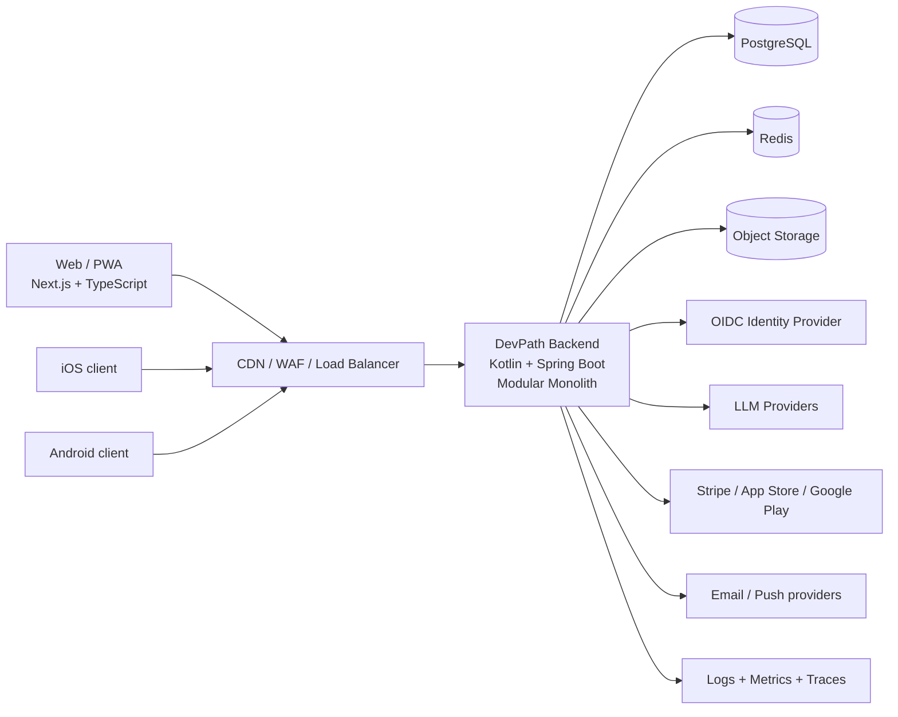
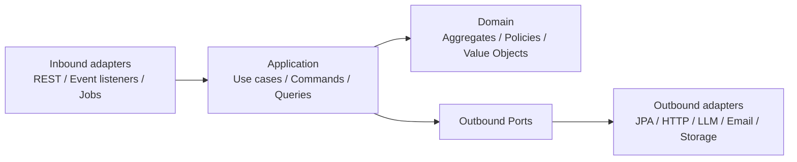
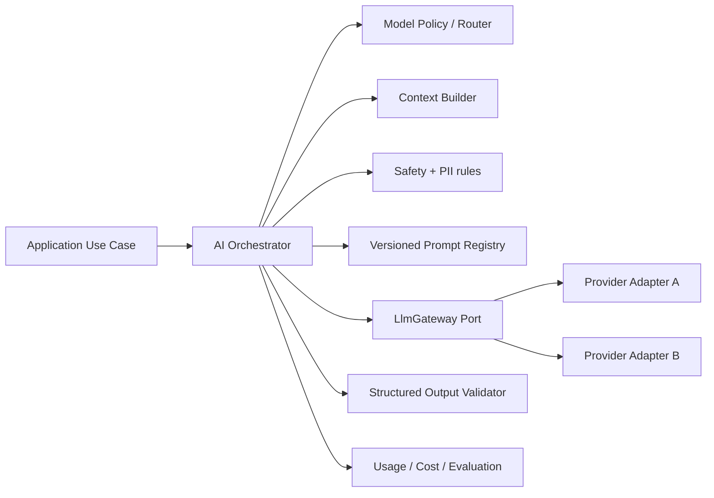
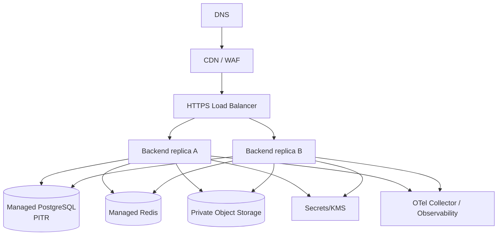
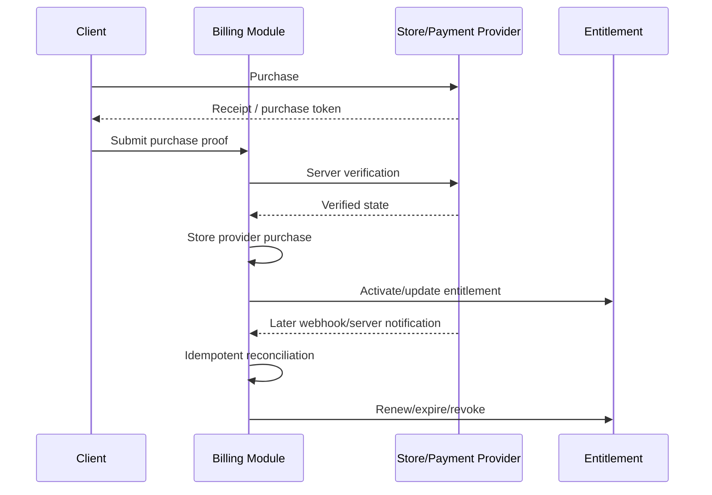

Here is the result of "fetch" for the Page with URL https://app.notion.com/p/3eaed85e8cef8112bce8fce20dc2d748 as of 2026-10-14T19:23:11.842Z:
<page url="https://app.notion.com/p/3eaed85e8cef8112bce8fce20dc2d748" icon="🧠">
<ancestor-path></ancestor-path>
<properties>
{"title":"AI Learning App для IT — полный план продукта"}
</properties>
<iconMetadata>{"type":"emoji","emoji":"🧠"}</iconMetadata>
<content>
> **Цель документа:** спроектировать полноценное AI Learning App для IT, которое можно довести от идеи до публичного релиза и первых платящих пользователей.
<callout icon="🎯" color="blue_bg">
	**Основная идея:** персональный AI-наставник для разработчиков и людей, входящих в IT. Приложение строит индивидуальный roadmap, ежедневно выдаёт задания, объясняет темы, проводит тесты и mock interviews, анализирует прогресс и адаптирует обучение под цель пользователя.
</callout>
# 1. Что за продукт
Рабочее название: **DevPath AI**.
Пользователь указывает:
- текущий уровень;
- направление: Backend / Frontend / QA / Data / DevOps / Mobile;
- стек: Java, Kotlin, Python, JavaScript и т.д.;
- опыт;
- английский;
- карьерную цель;
- желаемый срок достижения;
- сколько времени готов учиться в день.
Приложение создаёт персональный план и каждый день отвечает на вопрос: **что конкретно мне сегодня делать, чтобы приблизиться к моей цели?**
Пример цели: Junior Kotlin Backend → Middle Backend → международные собеседования.
# 2. Главная ценность
Проблемы пользователя:
- не понимает, что учить;
- прыгает между курсами;
- не видит прогресс;
- не знает, готов ли к собеседованию;
- сложно сохранять дисциплину;
- материалы часто не соответствуют реальному уровню;
- сложно получить качественную обратную связь;
- непонятно, какие пробелы критичны именно для выбранной вакансии.
Решение:
- единый roadmap;
- адаптивный AI tutor;
- ежедневный learning plan;
- система повторения;
- практика;
- проекты;
- interview preparation;
- измеримый прогресс.
# 3. Целевая аудитория
## Основная
1. Студенты, которые хотят войти в IT.
2. Junior-разработчики, желающие перейти на Middle.
3. Middle-разработчики, готовящиеся к международным компаниям.
4. Разработчики, меняющие стек.
5. Люди, готовящиеся к техническим интервью.
## Дополнительная
- bootcamp-выпускники;
- self-taught developers;
- специалисты после перерыва;
- компании для внутреннего обучения сотрудников.
# 4. Пользовательские сценарии
## Первый запуск
1. Регистрация.
2. Выбор карьерной цели.
3. Диагностический тест.
4. Self-assessment.
5. Выбор количества времени в день.
6. Формирование roadmap.
7. Создание первой недели обучения.
## Ежедневное использование
1. Пользователь открывает Home.
2. Видит Today’s Plan.
3. Изучает одну тему.
4. Решает задачу.
5. Проходит короткий quiz.
6. AI анализирует ошибки.
7. Прогресс пересчитывается.
8. Следующие задания адаптируются.
## Подготовка к интервью
1. Пользователь выбирает роль.
2. Добавляет вакансию или описание требований.
3. AI выделяет skills.
4. Сравнивает их с профилем.
5. Формирует gap analysis.
6. Создаёт interview plan.
7. Проводит mock interview.
8. Выдаёт feedback.
# 5. Основные модули
## Dashboard
Показывать:
- текущую цель;
- общий прогресс;
- streak;
- количество часов обучения;
- слабые темы;
- сильные темы;
- задания на сегодня;
- ближайший milestone;
- прогноз готовности.
## Roadmap
Структура: Career Goal → Skills → Topics → Lessons → Practice → Assessment.
Пример Backend Engineer:
- Java/Kotlin;
- JVM;
- Spring;
- SQL;
- REST;
- Git;
- Docker;
- Kafka;
- Testing;
- System Design;
- Algorithms;
- English for interviews.
Каждая тема имеет: статус, уровень владения, priority, prerequisites, estimated hours и confidence score.
## AI Tutor
Должен уметь:
- объяснять тему;
- менять сложность;
- давать аналогии;
- задавать уточняющие вопросы;
- проверять понимание;
- генерировать примеры;
- разбирать код;
- не выдавать готовый ответ мгновенно при learning mode;
- давать hints;
- строить follow-up задания.
Режимы: Learn, Explain simply, Deep dive, Quiz me, Practice, Interview mode.
## Lessons
Каждый урок содержит:
- цель;
- короткое объяснение;
- пример;
- interactive question;
- mini quiz;
- practice task;
- summary;
- references;
- next step.
## Practice
Типы заданий:
- multiple choice;
- short answer;
- code task;
- debug task;
- design question;
- SQL task;
- architecture reasoning;
- interview question.
## Coding Playground
Минимум:
- редактор кода;
- запуск;
- тесты;
- stdout/stderr;
- hidden tests;
- ограничения CPU/RAM/time;
- sandbox.
Для MVP допустимо начать без полноценного execution engine и позже добавить изолированный sandbox.
## Knowledge Assessment
У пользователя должен быть skill graph.
Уровни: unknown → learning → familiar → confident → mastered.
Оценка строится по quiz results, повторным попыткам, сложности заданий, времени ответа, ошибкам и повторениям.
## Spaced Repetition
Хранить:
- last_reviewed_at;
- confidence;
- error_rate;
- next_review_at;
- review_count.
## AI Mock Interview
Форматы:
- текст;
- голос позже;
- behavioral;
- algorithms;
- backend;
- system design;
- language-specific.
После интервью:
- итог;
- сильные стороны;
- слабые стороны;
- missed concepts;
- структура ответа;
- suggested answer;
- follow-up plan.
## Job Gap Analyzer
Пользователь вставляет вакансию. Сервис извлекает skills, определяет must-have, сравнивает с профилем, показывает gaps и создаёт план подготовки.
# 6. Онбординг
Онбординг должен занимать не больше 5–8 минут.
Шаги:
1. Кто ты?
2. Текущая роль.
3. Опыт.
4. Стек.
5. Цель.
6. Срок.
7. Время в день.
8. Английский.
9. Диагностика.
10. Генерация roadmap.
Не перегружать пользователя вопросами до первой ценности.
# 7. UX/UI
Основные экраны:
- Landing;
- Sign Up / Sign In;
- Onboarding;
- Home;
- Roadmap;
- Lesson;
- Practice;
- AI Tutor;
- Interview;
- Progress;
- Profile;
- Billing;
- Settings.
Главный экран должен отвечать на 3 вопроса:
1. Что делать сегодня?
2. Насколько я продвинулся?
3. Что мешает двигаться быстрее?
# 8. MVP
## В MVP обязательно
- регистрация;
- onboarding;
- выбор направления;
- персональный roadmap;
- ежедневный plan;
- AI Tutor;
- lessons;
- quizzes;
- progress tracking;
- streak;
- basic skill scoring;
- простой interview mode;
- subscription/paywall;
- admin panel;
- analytics;
- feedback form.
## Не нужно в первой версии
- social network;
- marketplace;
- live mentors;
- native mobile apps;
- сложный code execution;
- enterprise;
- огромная gamification-система;
- десятки профессий.
Начать с **одной сильной вертикали: Java/Kotlin Backend**.
# 9. Версия 1.0 после MVP
Добавить:
- полноценный coding sandbox;
- voice interviews;
- vacancy analyzer;
- CV analyzer;
- system design simulator;
- adaptive difficulty;
- spaced repetition;
- achievements;
- weekly reports;
- AI learning memory;
- advanced analytics;
- referral system.
# 10. Архитектура
Рекомендуемый старт: **modular monolith**, не микросервисы.
Backend:
- Kotlin;
- Spring Boot;
- PostgreSQL;
- Redis;
- object storage;
- REST API;
- WebSocket/SSE для streaming;
- background jobs.
Frontend:
- React / Next.js;
- TypeScript;
- responsive UI.
Infrastructure:
- Docker;
- CI/CD;
- managed PostgreSQL;
- cloud hosting;
- CDN;
- centralized logging;
- monitoring;
- backups.
AI layer:
- abstraction layer над LLM providers;
- prompt templates;
- structured outputs;
- retries;
- rate limits;
- cost tracking;
- fallback model;
- evaluation pipeline.
# 11. Доменные сущности
- User;
- Profile;
- CareerGoal;
- Skill;
- SkillLevel;
- Roadmap;
- RoadmapItem;
- Lesson;
- Quiz;
- Question;
- Answer;
- PracticeTask;
- Attempt;
- Progress;
- DailyPlan;
- AIConversation;
- InterviewSession;
- InterviewQuestion;
- Feedback;
- Subscription;
- Payment;
- AuditEvent.
# 12. AI-архитектура
LLM не должен быть единственным источником истины.
Использовать:
- curated knowledge;
- versioned prompts;
- structured JSON outputs;
- validation;
- deterministic business rules;
- RAG там, где он действительно нужен;
- citations/references для сложных технических материалов;
- moderation;
- token limits.
## AI evaluation
Проверять:
- factual correctness;
- hallucinations;
- relevance;
- difficulty;
- consistency;
- answer quality;
- response latency;
- cost.
Создать regression dataset из реальных вопросов.
# 13. Контент
Не генерировать весь образовательный материал на лету.
Подход:
1. curriculum и learning objectives подготовлены заранее;
2. AI адаптирует объяснение;
3. AI создаёт дополнительные примеры;
4. AI генерирует practice;
5. ключевые ответы проходят validation.
Java/Kotlin Backend curriculum:
- programming basics;
- OOP;
- Java;
- Kotlin;
- collections;
- generics;
- exceptions;
- concurrency;
- coroutines;
- JVM;
- Spring;
- REST;
- HTTP;
- SQL;
- PostgreSQL;
- transactions;
- testing;
- Git;
- Docker;
- Kafka;
- caching;
- security basics;
- observability;
- distributed systems;
- algorithms;
- system design.
# 14. Персонализация
Система учитывает цель, сроки, опыт, время, скорость обучения, ошибки, предпочитаемый формат, confidence и историю.
Если пользователь стабильно силён в SQL, но ошибается в concurrency, система уменьшает долю SQL и увеличивает concurrency.
# 15. Gamification
Использовать умеренно:
- streak;
- XP;
- levels;
- milestones;
- weekly goal;
- badges;
- completion animations.
Не превращать техническое обучение в бессмысленный сбор очков.
# 16. Монетизация
## Free
- ограниченный roadmap;
- несколько AI-запросов в день;
- basic quizzes;
- limited progress.
## Pro
Ориентир на старте: **\$10–20/месяц**.
- расширенный AI Tutor;
- interviews;
- gap analyzer;
- deeper analytics;
- spaced repetition;
- увеличенные лимиты.
## Позже
- Team;
- University;
- Company plans.
Цену обязательно валидировать через реальные продажи и willingness-to-pay interviews.
# 17. Метрики
## Acquisition
- landing conversion;
- signup rate;
- source;
- CAC.
## Activation
Главная activation event: **пользователь завершил onboarding и выполнил первое задание**.
## Engagement
- DAU;
- WAU;
- lessons/week;
- practice attempts;
- AI sessions;
- streak.
## Retention
- D1;
- D7;
- D30.
## Learning
- skill improvement;
- repeated mistakes;
- completion;
- assessment delta.
## Revenue
- free → paid conversion;
- MRR;
- ARPU;
- churn;
- LTV.
# 18. Admin Panel
Управлять:
- users;
- subscriptions;
- lessons;
- skills;
- roadmap templates;
- questions;
- AI prompts;
- feature flags;
- reports;
- feedback;
- blocked users;
- AI costs.
# 19. Безопасность
Обязательно:
- password hashing;
- OAuth;
- email verification;
- secure sessions/JWT;
- rate limiting;
- CSRF protection;
- CORS policy;
- input validation;
- secrets manager;
- encryption in transit;
- least privilege;
- audit logs;
- dependency scanning;
- SAST;
- backups;
- restore tests;
- account deletion;
- export user data.
Для code execution:
- отдельная sandbox environment;
- no host filesystem access;
- no unrestricted networking;
- CPU limit;
- memory limit;
- execution timeout;
- process isolation;
- abuse controls.
# 20. Privacy и legal
Подготовить до релиза:
- Privacy Policy;
- Terms of Service;
- Cookie Policy при необходимости;
- data deletion process;
- data export;
- retention policy;
- consent management;
- список third-party processors.
Не отправлять персональные данные в LLM без необходимости.
# 21. Payments
Нужно:
- checkout;
- subscription lifecycle;
- upgrade;
- downgrade;
- cancellation;
- payment failure;
- grace period;
- invoices;
- webhook verification;
- idempotency;
- refund flow.
# 22. Email
Минимальные письма:
- verification;
- welcome;
- password reset;
- payment success;
- payment failed;
- subscription canceled;
- weekly learning report;
- inactivity reminder.
# 23. Notifications
На старте:
- email;
- in-app.
Позже:
- push;
- Telegram/Discord integrations.
# 24. Observability
До релиза:
- structured logging;
- metrics;
- traces;
- error tracking;
- dashboards;
- alerts;
- AI request latency;
- AI cost;
- failed payments;
- signup anomalies;
- DB health.
# 25. Testing
## Unit
Проверить progress, skill calculation, subscription, roadmap, spaced repetition.
## Integration
Проверить database, Redis, AI adapter mocks, payment webhooks, email.
## API
Contract tests, auth, permissions, validation.
## E2E
Критические пути:
1. registration;
2. onboarding;
3. first lesson;
4. quiz;
5. AI Tutor;
6. payment;
7. cancel subscription;
8. delete account.
## AI tests
Golden dataset: 100+ representative questions, expected concepts, forbidden mistakes и scoring.
# 26. Performance
Проверить:
- load test;
- DB indexes;
- N+1 queries;
- caching;
- AI streaming;
- API latency;
- concurrency;
- timeouts;
- retry policy;
- circuit breakers.
# 27. Accessibility
Минимум:
- keyboard navigation;
- semantic HTML;
- contrast;
- labels;
- focus states;
- responsive layout;
- readable font sizes.
# 28. Environments
- local;
- dev;
- staging;
- production.
Production deploy: merge → CI → tests → image → staging → smoke tests → production → health check.
# 29. CI/CD
Pipeline:
1. lint;
2. compile;
3. unit tests;
4. integration tests;
5. security scan;
6. frontend build;
7. Docker build;
8. staging deploy;
9. smoke;
10. production deploy.
# 30. Backup & Disaster Recovery
Определить:
- backup frequency;
- retention;
- restore procedure;
- RPO;
- RTO.
Восстановление backup должно реально проверяться.
# 31. Feature Flags
Нужны для:
- новых AI моделей;
- interview mode;
- pricing experiments;
- beta features;
- безопасного rollout.
# 32. Anti-abuse
Защита от:
- ботов;
- prompt abuse;
- token farming;
- shared accounts;
- scraping;
- excessive code execution;
- payment fraud.
# 33. Поддержка
До релиза:
- support email;
- feedback form;
- bug report;
- FAQ.
# 34. Launch Strategy
## Pre-launch
- landing;
- waitlist;
- 20–50 интервью с потенциальными пользователями;
- screenshots;
- demo;
- analytics;
- pricing hypothesis.
## Closed beta
Цель: 30–100 пользователей.
Проверять:
- понимают ли продукт без объяснений;
- возвращаются ли;
- какие функции реально нужны;
- за что готовы платить.
## Public beta
Каналы:
- Product Hunt;
- Reddit;
- Habr;
- X;
- Threads;
- TikTok;
- YouTube;
- Instagram;
- developer communities.
# 35. Контент-маркетинг
Темы:
- как строится AI Learning App;
- архитектура;
- backend decisions;
- ошибки разработки;
- AI evaluation;
- первые пользователи;
- product metrics;
- lessons learned.
Один материал можно выпускать в RU и EN версиях.
# 36. Что должно быть доказано до масштабирования
- пользователи проходят onboarding;
- возвращаются;
- реально учатся;
- рекомендуют;
- часть готова платить;
- AI стабильно полезен;
- AI cost не уничтожает unit economics.
# 37. Roadmap разработки
## Phase 0 — Discovery
- [ ] 20–50 интервью
- [ ] определить одну аудиторию
- [ ] выбрать одну карьерную цель
- [ ] landing
- [ ] waitlist
## Phase 1 — Foundation
- [ ] repository
- [ ] backend
- [ ] frontend
- [ ] DB
- [ ] auth
- [ ] CI/CD
- [ ] staging
## Phase 2 — Learning Core
- [ ] onboarding
- [ ] roadmap
- [ ] lessons
- [ ] quiz
- [ ] progress
## Phase 3 — AI
- [ ] AI Tutor
- [ ] structured output
- [ ] prompts
- [ ] evaluations
- [ ] cost controls
## Phase 4 — Product
- [ ] daily plan
- [ ] streak
- [ ] interview MVP
- [ ] analytics
- [ ] feedback
## Phase 5 — Monetization
- [ ] pricing
- [ ] payments
- [ ] subscriptions
- [ ] limits
- [ ] billing portal
## Phase 6 — Hardening
- [ ] security review
- [ ] load tests
- [ ] backups
- [ ] monitoring
- [ ] legal pages
- [ ] E2E
## Phase 7 — Beta
- [ ] 30–100 users
- [ ] fix onboarding
- [ ] retention measurement
- [ ] pricing validation
## Phase 8 — Release
- [ ] production
- [ ] landing
- [ ] payment
- [ ] support
- [ ] launch campaign
- [ ] dashboards
# 38. Definition of Done для публичного релиза
- [ ] новый пользователь регистрируется самостоятельно;
- [ ] email/auth стабильны;
- [ ] onboarding понятен;
- [ ] roadmap генерируется;
- [ ] lesson проходится;
- [ ] quiz работает;
- [ ] прогресс сохраняется;
- [ ] AI Tutor отвечает стабильно;
- [ ] AI outputs валидируются;
- [ ] критические hallucination cases протестированы;
- [ ] подписка покупается;
- [ ] отмена подписки работает;
- [ ] payment webhooks идемпотентны;
- [ ] ошибки пользователя не приводят к 500;
- [ ] есть rate limits;
- [ ] есть logs/metrics/errors;
- [ ] есть alerts;
- [ ] есть backups;
- [ ] restore проверен;
- [ ] Privacy Policy опубликована;
- [ ] Terms опубликованы;
- [ ] account deletion работает;
- [ ] support доступен;
- [ ] analytics работают;
- [ ] критические E2E тесты зелёные;
- [ ] mobile layout usable;
- [ ] нет известных critical/high security issues;
- [ ] есть rollback plan.
# 39. Главные риски
## Слишком широкий продукт
Решение: начать с Java/Kotlin Backend.
## AI отвечает неправильно
Решение: curated content + validation + evals.
## Пользователи не возвращаются
Решение: discovery + retention-first product design.
## Высокая стоимость AI
Решение: model routing, caching, limits и дешёвые модели для простых задач.
## Слишком долго делать
Решение: MVP должен доказать learning loop, а не содержать все идеи.
## Нет платежеспособного спроса
Решение: pricing interviews и pre-sale до долгой разработки.
# 40. Позиционирование
**DevPath AI — персональный AI-наставник для разработчиков, который превращает карьерную цель в ежедневный адаптивный план обучения и подготовки к интервью.**
Это не просто chatbot, не просто курс и не просто roadmap.
Главная ценность — **адаптивная система обучения, которая знает цель пользователя, его пробелы и историю прогресса**.
# 41. Главная продуктовая гипотеза
> Если разработчику дать персональный roadmap, ежедневный plan, AI feedback и измеримый skill progress в одном продукте, он будет учиться стабильнее и быстрее, чем при самостоятельном использовании разрозненных курсов, YouTube и AI-chat.
Именно эту гипотезу нужно доказать первой.
---
# Production Architecture & Release Playbook — принятое техническое решение
<callout icon="🏗️" color="blue_bg">
	**Статус:** этот раздел является техническим source of truth для реализации DevPath AI. Если старые архитектурные заметки выше конфликтуют с этим разделом, приоритет у этого раздела.
	**Принято:** Modular Monolith + Hexagonal/Clean Architecture + event-driven взаимодействие внутри приложения + stateless backend.
	**Цель:** быстро выпустить MVP, не строя преждевременные микросервисы, но сохранить жёсткие границы модулей и возможность позже вынести отдельные части без переписывания всего продукта.
</callout>
<table_of_contents/>
## 1. Архитектурные принципы
1. **Один deployable backend на старте**, но внутри — независимые бизнес-модули.
2. Каждый модуль **владеет своей моделью, таблицами, use cases и repository interfaces**.
3. Модуль не имеет права читать JPA Entity/Repository другого модуля.
4. Синхронное взаимодействие между модулями — только через публичный application API/facade.
5. Асинхронное — через versioned application/domain events.
6. Общий `shared-kernel` должен быть минимальным: идентификаторы, базовые value objects, общие error/clock primitives. Бизнес-логика туда не попадает.
7. База данных одна PostgreSQL, но владение таблицами разделено по схемам/модулям.
8. Redis — ускоритель, а не источник истины. Потеря Redis не должна приводить к потере пользовательских данных.
9. Backend stateless на уровне обработки HTTP-запросов: любой запрос может обслужить любая реплика; никакой важной пользовательской сессии в RAM конкретного инстанса.
10. Все внешние провайдеры подключаются через ports/adapters, чтобы LLM, платежи, email, object storage и identity provider можно было заменить.
11. Любая внешняя side effect операция должна быть идемпотентной или защищена idempotency key/event id.
12. Все изменения БД — только versioned migrations; production schema никогда не меняется вручную.
13. API и события считаются контрактами и меняются backward-compatible способом.
14. Безопасность, privacy и observability проектируются сразу, а не добавляются перед релизом.
## 2. System context

**Не делаем:** отдельный auth-service, roadmap-service, AI-service, payment-service и Kafka-кластер только ради «микросервисной архитектуры». Всё это сначала модули одного приложения.
## 3. Технологический baseline
### Backend
- Kotlin.
- Spring Boot.
- Spring Security.
- Spring Modulith для проверки границ модулей, module tests и надёжного внутреннего event publication.
- PostgreSQL.
- Redis.
- Liquibase для миграций.
- REST/JSON для основного API.
- SSE для streaming ответа AI; WebSocket добавлять только там, где действительно нужна двусторонняя realtime-связь, например live voice interview.
- OpenAPI 3.x как контракт внешнего API.
- Testcontainers для PostgreSQL/Redis integration tests.
- OpenTelemetry для traces/metrics correlation.
### Frontend
- Next.js + React + TypeScript.
- API client генерировать из OpenAPI либо держать строго типизированным единым SDK.
- PWA как первый mobile-friendly канал.
### Mobile
- После подтверждения retention/монетизации: React Native + TypeScript как рекомендуемый путь, потому что команда уже использует React/TypeScript на web и сможет переиспользовать API SDK, модели контрактов и часть utility-кода.
- Backend API при этом не меняется специально под mobile.
### Infrastructure
- Docker/OCI image.
- Managed container platform на старте; Kubernetes только после появления реальной эксплуатационной причины.
- Managed PostgreSQL с point-in-time recovery.
- Managed Redis.
- S3-compatible object storage.
- CDN + managed TLS.
- Secrets Manager/KMS.
- Infrastructure as Code: Terraform/OpenTofu.
## 4. Hexagonal/Clean Architecture внутри каждого модуля
Каждый бизнес-модуль имеет четыре логические зоны.

### Domain
Содержит бизнес-правила и не знает про Spring MVC, JPA, Redis, HTTP или конкретную LLM.
Примеры: `SkillScore`, `Roadmap`, `LearningGoal`, `AssessmentResult`, `SubscriptionEntitlement`.
### Application
Оркестрирует use cases и transaction boundaries.
Примеры: `CompleteLessonUseCase`, `GenerateRoadmapUseCase`, `SubmitAnswerUseCase`.
### Ports
Интерфейсы, через которые application/domain получает внешние возможности.
Примеры: `RoadmapRepository`, `LlmGateway`, `PaymentGateway`, `ObjectStorage`, `NotificationSender`.
### Adapters
Конкретная реализация портов: Spring Data/JDBC, OpenAI/Anthropic adapter, Stripe adapter, S3 adapter и т.д.
## 5. Рекомендуемые backend-модули
<table fit-page-width="true" header-row="true">
<tr>
<td>Модуль</td>
<td>Ответственность</td>
<td>Ключевые сущности</td>
</tr>
<tr>
<td>`identity-access`</td>
<td>Связь внешней identity с внутренним user id, roles, bans, device sessions/refresh grants</td>
<td>Identity, Role, RefreshGrant</td>
</tr>
<tr>
<td>`user-profile`</td>
<td>Профиль, опыт, стек, язык, цель обучения, настройки</td>
<td>UserProfile, CareerGoal</td>
</tr>
<tr>
<td>`curriculum`</td>
<td>Версионированный curated curriculum и prerequisites</td>
<td>Skill, Topic, LessonDefinition, CurriculumVersion</td>
</tr>
<tr>
<td>`assessment`</td>
<td>Диагностика, quiz, вопросы, attempts, scoring input</td>
<td>Assessment, Question, Attempt, Answer</td>
</tr>
<tr>
<td>`progress`</td>
<td>Skill graph, mastery/confidence, history</td>
<td>SkillProgress, ProgressSnapshot</td>
</tr>
<tr>
<td>`roadmap`</td>
<td>Персональный roadmap и milestones</td>
<td>Roadmap, RoadmapItem, Milestone</td>
</tr>
<tr>
<td>`learning-plan`</td>
<td>Daily/weekly plan, scheduling, spaced repetition</td>
<td>DailyPlan, PlannedActivity, ReviewSchedule</td>
</tr>
<tr>
<td>`learning-session`</td>
<td>Прохождение уроков и практики</td>
<td>LearningSession, LessonAttempt, PracticeAttempt</td>
</tr>
<tr>
<td>`ai-orchestration`</td>
<td>LLM routing, prompts, structured output, safety, quotas, cost</td>
<td>PromptVersion, AIRequest, AIUsage</td>
</tr>
<tr>
<td>`conversation`</td>
<td>AI tutor threads и сообщения</td>
<td>Conversation, Message</td>
</tr>
<tr>
<td>`interview`</td>
<td>Mock interview flow и feedback</td>
<td>InterviewSession, InterviewTurn, InterviewReport</td>
</tr>
<tr>
<td>`billing`</td>
<td>Products, subscriptions, receipts/webhooks, entitlement</td>
<td>Subscription, Payment, Entitlement</td>
</tr>
<tr>
<td>`notification`</td>
<td>Email/push/in-app notifications</td>
<td>Notification, DeviceToken, Preference</td>
</tr>
<tr>
<td>`files`</td>
<td>Metadata файлов, upload/download policy, scan state</td>
<td>StoredFile</td>
</tr>
<tr>
<td>`analytics`</td>
<td>Product events без превращения analytics в business source of truth</td>
<td>AnalyticsEvent</td>
</tr>
<tr>
<td>`audit`</td>
<td>Security/admin audit trail</td>
<td>AuditRecord</td>
</tr>
<tr>
<td>`admin`</td>
<td>Curated content management, moderation, support tools</td>
<td>Admin actions поверх публичных API модулей</td>
</tr>
</table>
### Модули после MVP
`job-gap`, `cv-analysis`, `referral`, `organization/team`, `coding-sandbox`, `voice` добавлять после подтверждённого спроса.
## 6. Жёсткие правила границ
- `roadmap` не импортирует `assessment.persistence.AssessmentEntity`.
- `progress` не ходит напрямую в таблицы `learning_session`.
- `billing` не меняет `user_profile` через repository.
- `admin` не получает «супер-репозиторий ко всей БД».
- Межмодульный синхронный вызов идёт через `module.api.*`.
- Межмодульная реакция на факт идёт через `module.api.events.*`.
- DTO внешнего REST API не становятся domain model.
- JPA entities не возвращаются наружу из persistence adapter.
- Межмодульные JPA `@ManyToOne/@OneToMany` запрещены. Передаётся только идентификатор.
- Изменить чужую таблицу может только владеющий ею модуль.
## 7. Структура репозитория
```plain text
devpath/
  backend/
    app/                         # Spring Boot bootstrap, composition root
    modules/
      identity-access/
      user-profile/
      curriculum/
      assessment/
      progress/
      roadmap/
      learning-plan/
      learning-session/
      ai-orchestration/
      conversation/
      interview/
      billing/
      notification/
      files/
      analytics/
      audit/
      admin/
    shared-kernel/
    architecture-tests/
  web/
  mobile/                        # появляется позже
  infra/
    terraform/
    docker/
    monitoring/
  docs/
    adr/
    api/
    runbooks/
    security/
```
Внутри каждого модуля:
```plain text
roadmap/
  api/                           # то, что разрешено импортировать другим модулям
    RoadmapFacade.kt
    events/
  domain/
    model/
    service/
  application/
    command/
    query/
    port/in/
    port/out/
  adapter/
    in/web/
    in/event/
    out/persistence/
    out/http/
  config/
```
## 8. Enforcement архитектуры
В CI должны выполняться автоматические архитектурные тесты:
- Spring Modulith `ApplicationModules.verify()`.
- ArchUnit: запрет доступа в чужие `domain`, `application`, `adapter` packages.
- запрет зависимостей domain → Spring/JPA/web.
- запрет межмодульных entity relationships.
- циклические зависимости модулей = build failure.
- документация модулей/диаграммы генерируются из реального кода.
## 9. Взаимодействие модулей: когда sync, когда event
### Синхронный вызов
Использовать, когда вызывающему модулю **нужен результат прямо сейчас**, чтобы завершить свой use case.
Пример: `learning-plan` спрашивает `progress` текущий skill state перед построением плана.
### Event
Использовать, когда произошло событие-факт, на которое могут реагировать 0..N модулей.
Пример: `LessonCompleted` → progress пересчитывает skill score; analytics пишет событие; notification может проверить milestone.
### Главный принцип
**Command просит что-то сделать. Event сообщает, что что-то уже произошло.**
## 10. Event-driven внутри монолита
На старте не нужен Kafka. Использовать Spring application events + Spring Modulith Event Publication Registry для transactional listeners. Публикация фиксируется вместе с бизнес-транзакцией; неуспешная обработка остаётся незавершённой и может быть повторена.
### Базовые события
- `UserRegisteredV1`
- `OnboardingCompletedV1`
- `DiagnosticAssessmentCompletedV1`
- `RoadmapGeneratedV1`
- `DailyPlanGeneratedV1`
- `LessonStartedV1`
- `LessonCompletedV1`
- `PracticeAttemptSubmittedV1`
- `AssessmentCompletedV1`
- `SkillScoreChangedV1`
- `MilestoneReachedV1`
- `InterviewCompletedV1`
- `SubscriptionActivatedV1`
- `SubscriptionExpiredV1`
- `AccountDeletionRequestedV1`
### Event envelope
```json
{
  "eventId": "uuid",
  "eventType": "lesson.completed.v1",
  "occurredAt": "2026-10-14T18:00:00Z",
  "aggregateId": "uuid",
  "actorUserId": "uuid",
  "correlationId": "uuid",
  "causationId": "uuid|null",
  "payload": {}
}
```
### Гарантии
- Семантика обработчиков: **at-least-once**, поэтому consumer обязан быть идемпотентным.
- `eventId` хранится у обработчика, если повторная обработка может создать дубль.
- Side effects (email, push, внешняя аналитика) выполняются после commit бизнес-данных.
- Никаких «отправили email/LLM/payment webhook, потом transaction rollback».
- Не делать distributed transaction.
- При появлении нескольких deployables — selected events можно externalize через outbox в Kafka/RabbitMQ без изменения domain semantics.
## 11. Транзакционные границы
- Один application command/use case = обычно одна DB transaction.
- Aggregate изменяется внутри transaction.
- Domain/application event создаётся в той же transaction.
- Внутренний listener, который меняет связанные локальные данные и должен быть atomic, может быть transactional.
- Внешний HTTP/LLM/email/payment side effect не должен удерживать длинную DB transaction.
- Для внешнего side effect: commit → durable event/job → обработка → retry.
- Retry только с backoff+jitter и только там, где операция безопасна/идемпотентна.
## 12. PostgreSQL и владение данными
### Один кластер, логически разделённые данные
Рекомендуемый старт:
```plain text
postgresql
  identity.*
  profile.*
  curriculum.*
  assessment.*
  progress.*
  roadmap.*
  learning_plan.*
  learning_session.*
  conversation.*
  interview.*
  billing.*
  notification.*
  files.*
  audit.*
  event_publication.*
```
Каждый модуль имеет отдельный migration path и знает только свои таблицы.
### Правила моделирования
- Primary key: UUID. Для новых таблиц можно принять UUIDv7, если выбранная библиотека и инфраструктура проверены; иначе UUIDv4 безопаснее и проще.
- Все timestamps в БД — UTC (`timestamptz`).
- День/час пользователя вычислять через его IANA timezone, например `Europe/Vilnius`, а не хранить «локальный timestamp без зоны».
- Деньги: integer minor units + currency (`amount_minor`, `currency`) либо `NUMERIC` с явной scale; никогда `Double`.
- Проценты/score — `NUMERIC`, если нужна точная арифметика.
- Enum, который может расширяться, не привязывать бездумно к PostgreSQL enum; строка + CHECK зачастую проще для миграций.
- Soft delete использовать только там, где реально нужен restore/audit. Не заменять им GDPR deletion.
- Для optimistic concurrency у изменяемых агрегатов — `version` (`@Version`) либо compare-and-set update.
- Уникальные бизнес-инварианты защищать DB constraint, а не только `if` в Kotlin.
- Для внешних webhook/event identifiers — unique constraint для идемпотентности.
### Межмодульные ссылки
Хранить чужой идентификатор как opaque UUID. Не строить cross-module ORM graph.
Пример: `roadmap.user_id` — UUID, но Roadmap JPA entity не содержит `@ManyToOne UserEntity`.
### Миграции production
Использовать **expand → migrate → contract**:
1. добавить новый nullable column/table;
2. задеплоить код, умеющий старый+новый формат;
3. backfill;
4. переключить чтение;
5. сделать constraint;
6. только в следующем релизе удалить старое.
Так mobile/web старой версии и новая backend-версия не ломают друг друга.
### Backup
- Point-in-time recovery.
- Ежедневный automated backup.
- Периодический restore drill в отдельное окружение.
- Backup считается рабочим только после проверенного восстановления.
## 13. Redis
Redis разрешён для:
- short-lived cache;
- distributed rate limits;
- временных idempotency locks;
- lightweight distributed coordination;
- AI quota counters;
- ephemeral streaming metadata.
Redis **не хранит единственную копию** roadmap, progress, subscription или платежей.
### Cache pattern
- cache-aside;
- TTL;
- namespace/version ключей;
- stampede protection для дорогих операций;
- cache invalidation событием либо коротким TTL;
- приложение должно корректно работать при полном flush Redis, просто медленнее.
## 14. Object Storage
Все пользовательские файлы и крупные артефакты — private bucket.
- Backend выдаёт короткоживущий presigned upload/download URL.
- Bucket не public.
- Проверять MIME, размер, extension и magic bytes.
- Пользовательское имя файла не становится storage path.
- Random object key.
- Антивирус/scan pipeline перед использованием потенциально опасного файла.
- Upload status: `PENDING → UPLOADED → SCANNING → READY/REJECTED`.
- CV/vacancy attachments никогда не исполняются и рассматриваются как недоверенный контент.
## 15. Stateless backend — точное значение
Stateless означает:
- нет `HttpSession` с бизнес-состоянием конкретного пользователя;
- запрос не зависит от памяти конкретной pod/VM;
- можно добавить/убрать replica без потери сессий;
- load balancer не требует sticky sessions;
- restart инстанса не ломает аккаунт/roadmap/subscription.
Stateless **не означает**, что нельзя иметь БД, refresh grants, Redis или durable jobs.
### Authentication
Рекомендуемый MVP: managed OIDC identity provider за собственным `IdentityProviderPort`, чтобы не хранить пароли и не строить reset/MFA/email-verification с нуля.
Backend всё равно владеет:
- внутренним `userId`;
- roles/permissions;
- account status;
- product entitlements;
- privacy/legal acceptance.
### Web auth
Предпочтительный flow:
1. Authorization Code + PKCE.
2. Короткоживущий access token.
3. Access token хранится в памяти web app, не в `localStorage`.
4. Refresh credential — Secure + HttpOnly cookie либо provider-managed secure mechanism.
5. Refresh token rotation/replay detection.
6. HTTPS везде.
Актуальный IETF OAuth Security BCP рекомендует PKCE; для public clients refresh token должен быть sender-constrained либо использовать rotation. [RFC 9700](https://datatracker.ietf.org/doc/rfc9700/)
### Mobile auth
- Authorization Code + PKCE.
- System browser / platform auth session, не встроенный WebView с вводом credentials.
- Refresh credentials в iOS Keychain / Android Keystore-backed secure storage.
- Access token short-lived.
- Logout отзывает refresh grant, а локальные токены удаляются.
### Authorization
Authentication отвечает «кто ты», authorization — «можешь ли ты выполнить именно это действие над именно этим объектом».
В каждом endpoint:
- проверка role/scope;
- проверка ownership/resource authorization;
- admin permission отдельно;
- нельзя доверять `userId` из request body — брать identity из verified security context.
OWASP API Security Top 10 отдельно выделяет Broken Object Level Authorization и Broken Authentication; эти проверки обязательны на всех endpoints с object identifiers. [OWASP API Security 2023](https://api-security.owasp.org/editions/2023/en/0x11-t10/)
## 16. API contract
### Общие правила
- Base path: `/api/v1/...`.
- JSON UTF-8.
- UTC timestamps ISO-8601.
- External IDs не переиспользовать.
- API DTO отделены от JPA/domain.
- OpenAPI публикуется из CI как versioned artifact.
- Web/mobile SDK генерируется из одного контракта.
### HTTP semantics
- `GET` — чтение.
- `POST` — создание/команда.
- `PUT` — полная идемпотентная замена, использовать редко.
- `PATCH` — частичное изменение.
- `DELETE` — удаление/инициация deletion.
- `202 Accepted` — долгий async процесс.
- `409 Conflict` — конфликт состояния/idempotency/version.
- `422` — валидный JSON, но business validation не прошла, если команда принимает такую семантику.
### Error contract
Использовать Problem Details (`application/problem+json`) с собственными стабильными error codes.
```json
{
  "type": "https://devpath.ai/problems/daily-plan-not-ready",
  "title": "Daily plan is not ready",
  "status": 409,
  "code": "DAILY_PLAN_NOT_READY",
  "detail": "Complete onboarding first",
  "traceId": "..."
}
```
Не отдавать stack trace, SQL, provider raw error, secrets, internal hostnames.
### Pagination
Cursor-based для больших списков:
```plain text
GET /api/v1/conversations?cursor=...&limit=50
```
Не использовать offset pagination там, где данные активно меняются.
### Idempotency
Для `POST /payments`, `POST /generation`, критичных retryable commands принимать `Idempotency-Key`.
Хранить:
- key;
- authenticated user/client;
- request hash;
- response/status;
- expiry.
Повтор с тем же key + другим body → conflict.
### Concurrency
Для editable resources поддержать `version`/ETag и optimistic locking, чтобы вкладки/устройства не перетирали изменения.
## 17. Streaming AI
Для текстового AI Tutor использовать SSE:
```plain text
POST /api/v1/ai/tutor/sessions/{id}/messages
→ 202 + generationId
GET /api/v1/ai/generations/{generationId}/stream
→ text/event-stream
```
Event types:
- `generation.started`
- `generation.delta`
- `generation.completed`
- `generation.failed`
- `generation.cancelled`
SSE stream не является source of truth. Итоговый message сохраняется в PostgreSQL. При reconnect клиент может получить финальный результат обычным GET.
## 18. AI Orchestration Layer
LLM никогда не вызывается напрямую из controller.

### Каждая AI операция описывается как product capability
Примеры:
- `TUTOR_EXPLANATION`;
- `QUIZ_GENERATION`;
- `ANSWER_FEEDBACK`;
- `ROADMAP_DRAFT`;
- `INTERVIEW_TURN`;
- `INTERVIEW_REPORT`;
- `VACANCY_SKILL_EXTRACTION`.
Для каждой capability хранить:
- prompt template version;
- model policy;
- max input/output tokens;
- temperature/reasoning policy;
- timeout;
- schema ответа;
- fallback;
- cost limit;
- safety policy;
- evaluation dataset.
### Structured outputs
Там, где результат влияет на бизнес-данные, LLM возвращает typed JSON/schema, затем backend валидирует его.
Нельзя доверять LLM полям `userId`, `price`, `subscription`, permissions или другим security-sensitive решениям.
### Prompt versioning
Хранить `promptKey + version + hash + deployedAt`. Для каждого AI result сохранять, какая версия prompt/model дала результат. Это нужно для regression, debugging и A/B.
### Provider abstraction
Domain/application знают только:
```kotlin
interface LlmGateway {
    suspend fun generate(request: LlmRequest): LlmResult
}
```
Provider-specific response, token field names и SDK types наружу не выходят.
### Timeouts и fallback
- connect timeout;
- total deadline;
- cancellation propagation;
- retry только на ограниченный набор transient errors;
- exponential backoff+jitter;
- circuit breaker при деградации provider;
- fallback model только если качество допустимо для capability.
### Cost control
На каждый request писать:
- capability;
- userId;
- model;
- input/output tokens;
- estimated/actual cost;
- latency;
- cache hit;
- outcome.
Лимиты:
- per user/day;
- per subscription tier;
- per request;
- global emergency budget ceiling.
### RAG
Не включать vector DB «потому что AI-приложение».
RAG нужен, когда требуется grounding по curated/versioned knowledge.
Pipeline:
`source → parse → chunk → metadata → embedding → index → retrieval → reranking → citations`.
Каждый chunk содержит `sourceId`, `version`, `topic`, `language`, `updatedAt`.
### Prompt injection
Любой текст пользователя, CV, вакансия, web content и document — **untrusted data**, а не instruction.
- отделять system/developer instruction от retrieved content;
- не разрешать retrieved text менять tool permissions;
- allowlist tools;
- ограничивать outbound URLs;
- запрещать secrets в model context;
- валидировать structured output;
- для tool calls иметь server-side authorization независимо от модели.
## 19. Skill scoring и персонализация
LLM не вычисляет итоговый mastery score напрямую.
Score рассчитывается deterministic service на основе versioned формулы.
Входы:
- correctness;
- difficulty;
- attempts;
- hints used;
- recency;
- response time только как слабый сигнал;
- spaced repetition result;
- confidence calibration.
LLM может классифицировать explanation/answer, но classification должен иметь schema, confidence и возможность manual/deterministic fallback.
Хранить историю score changes, чтобы объяснить пользователю, почему показатель изменился.
## 20. Security baseline
Ориентир для verification — минимум OWASP ASVS Level 2 для production приложения с аккаунтами и персональными данными. ASVS покрывает authentication, session management, access control, validation, cryptography, logging, data protection, communications и API. [OWASP ASVS](https://devguide.owasp.org/en/03-requirements/05-asvs/)
### Обязательные меры
- TLS only; HTTP → HTTPS.
- HSTS после корректной настройки доменов.
- Secure headers: CSP, `X-Content-Type-Options`, `Referrer-Policy`, frame protection.
- CORS allowlist; не `*` с credentials.
- CSRF protection для cookie-authenticated state-changing endpoints.
- Input validation на границе.
- Output encoding в UI.
- Parameterized SQL/ORM; никакой string SQL interpolation с user input.
- Server-side authorization для каждого resource.
- Request body/file size limits.
- Rate limits: auth, passwordless links, AI, uploads, feedback, expensive search.
- Brute-force/bot protection.
- Secrets только в secret manager.
- Dependency scanning + SCA.
- SAST.
- Secret scanning.
- Container image scanning.
- SBOM (CycloneDX/SPDX) на release artifact.
- MFA обязательно для production admin/cloud/App Store/Play Console.
- Production access по least privilege.
## 21. Secrets, keys и certificates
Создать inventory секретов и владельца каждого секрета.
### Backend/platform
- database credentials;
- Redis credentials;
- object storage credentials;
- LLM provider keys;
- email provider keys;
- payment webhook secrets;
- OAuth client secrets;
- signing/encryption keys;
- APNs key;
- FCM credentials;
- Apple/Google service credentials.
### Правила
- никогда не commit в Git;
- разные секреты для dev/stage/prod;
- rotation procedure;
- audit access;
- CI получает short-lived credentials через OIDC, где возможно;
- production developer laptop не должен хранить постоянный cloud admin key.
### TLS
Предпочтительно managed certificate/ACME с автоматическим renewal. Private key хранится у edge/load balancer и не лежит в repository.
### App cryptographic keys
Критические signing keys не передавать через чат, issue tracker или `.env` в репозитории.
## 22. Admin security
Admin panel — отдельная зона риска.
- отдельный admin role;
- MFA;
- no public self-registration;
- sensitive actions требуют re-auth либо step-up auth;
- immutable audit event на изменение curriculum, subscription override, ban, data export/deletion;
- отображать минимально необходимый PII;
- support impersonation, если когда-нибудь появится, только с явным banner, reason и audit trail;
- export user data — privileged action;
- secrets/LLM raw credentials в admin UI никогда не показывать.
## 23. Logging
Structured JSON:
```json
{
  "timestamp":"...",
  "level":"INFO",
  "service":"devpath-backend",
  "module":"assessment",
  "traceId":"...",
  "requestId":"...",
  "userIdHash":"...",
  "event":"assessment.completed",
  "durationMs":123
}
```
### Никогда не логировать
- password;
- access/refresh tokens;
- Authorization header;
- payment card data;
- full CV/user documents по умолчанию;
- raw LLM prompt с PII в обычный application log;
- OAuth authorization code;
- private keys;
- session cookies.
## 24. Observability
Три сигнала:
### Metrics
- request rate/error/latency;
- DB pool saturation;
- Redis errors;
- JVM CPU/memory/GC;
- AI latency/errors/cost/tokens;
- job queue lag;
- event publication failed/pending;
- payment webhook failures;
- signup/onboarding/activation technical funnel.
### Traces
OpenTelemetry trace проходит controller → application use case → SQL/external provider. `traceId` возвращается в error response для support.
### Logs
Коррелируются по `traceId`, `requestId`, `correlationId`.
### SLO examples
Определять после baseline нагрузки, но заранее завести:
- API availability;
- p95 latency non-AI endpoints;
- AI generation success rate;
- async job completion delay;
- payment entitlement reconciliation delay.
Не ставить SLO, который никто не измеряет.
## 25. Threat model до первой production-версии
Перед beta провести STRIDE-style threat modeling по главным data flows.
### Assets
- account identity;
- learning history;
- uploaded CV/vacancies;
- conversations with AI;
- payment/subscription state;
- admin access;
- provider API keys;
- signing keys;
- curriculum/admin content.
### Trust boundaries
- browser/mobile ↔ edge;
- edge ↔ backend;
- backend ↔ DB/Redis/object storage;
- backend ↔ identity provider;
- backend ↔ LLM;
- backend ↔ payment providers;
- backend ↔ notification providers;
- admin user ↔ admin API.
### Обязательные сценарии атак
- stolen access/refresh token;
- IDOR/BOLA: чтение чужого roadmap/conversation/file;
- mass assignment;
- account enumeration;
- brute force/magic-link abuse;
- CSRF/XSS;
- SSRF через URL/document processing;
- malicious file upload;
- prompt injection/tool injection;
- LLM cost abuse;
- webhook replay/forgery;
- subscription entitlement spoofing;
- leaked admin credential;
- leaked CI secret;
- supply-chain dependency compromise;
- database backup exposure;
- accidental PII in logs/analytics.
Для каждого риска: likelihood, impact, mitigation, detection, owner, residual risk.
## 26. Security testing program
### На каждый PR
- compiler/tests;
- architecture tests;
- SAST;
- dependency/SCA scan;
- secret scan;
- IaC validation;
- migration validation.
### На release candidate
- DAST against staging;
- auth/authorization negative tests;
- abuse/rate limit tests;
- webhook signature/replay tests;
- upload tests;
- backup/restore smoke test;
- dependency/container scan;
- mobile signing/config check.
### Перед публичным launch
- ручной security review;
- threat model review;
- penetration test желателен перед хранением большого объёма пользовательских документов/платежей либо B2B launch.
## 27. Environments
Минимум:
- `local`;
- `dev`;
- `stage`;
- `prod`.
### Никогда не смешивать
- databases;
- OAuth clients;
- payment modes/webhook secrets;
- LLM keys;
- object storage buckets;
- mobile push credentials;
- analytics projects.
Stage должен быть технически похож на prod, но без production user data.
Production data запрещено копировать в dev/stage без anonymization.
## 28. Infrastructure topology

### Production минимум
- 2 backend replicas, если платформа/бюджет позволяют;
- health/readiness probes;
- autoscaling по CPU/request concurrency + защита от бесконтрольного AI cost scaling;
- database connection pool limit рассчитан на суммарное количество replicas;
- rolling deployment;
- graceful shutdown;
- application не принимает новые requests после readiness=false;
- незавершённые durable jobs/events подхватываются другой replica/после restart.
## 29. Health endpoints
Разделить:
- `/actuator/health/liveness` — процесс жив;
- `/actuator/health/readiness` — можно ли направлять новый traffic.
Не делать liveness зависимым от временной недоступности LLM/почты: иначе orchestration убьёт здоровые процессы из-за внешнего provider.
## 30. CI/CD
### Pipeline

```mermaid
flowchart LR
    PR["Pull Request"] --> Q["Lint + Compile + Unit"]
    Q --> ARCH["Architecture tests"]
    ARCH --> INT["Integration/Testcontainers"]
    INT --> SEC["SAST + SCA + Secrets"]
    SEC --> IMG["Build OCI image + SBOM"]
    IMG --> STAGE["Deploy staging"]
    STAGE --> E2E["Smoke + E2E + migration check"]
    E2E --> APPROVE["Production gate"]
    APPROVE --> PROD["Rolling/Canary prod"]
    PROD --> VERIFY["Post-deploy verification"]
```

### Artifact rule
Один и тот же immutable image digest, проверенный на staging, продвигается в prod. Не пересобирать «тот же commit» отдельно для production.
### Deployment metadata
Сохранять:
- git commit SHA;
- image digest;
- migration version;
- deployment time;
- feature flag versions;
- prompt versions.
## 31. Rollback strategy
Backend rollback возможен только если migration backward-compatible.
Поэтому:
- destructive DB migration не совмещать с первым deploy нового кода;
- feature flags для опасных изменений;
- provider/model switch — runtime config с audit;
- mobile API должен поддерживать старые app versions минимум в оговорённом compatibility window;
- mobile binary нельзя считать мгновенно откатываемым: App Store/Play rollout медленнее server rollback.
### Emergency kill switches
Нужны switches для:
- AI generation;
- uploads;
- billing purchase initiation;
- push notifications;
- конкретной LLM model/provider;
- новой experimental feature.
## 32. Feature flags
Использовать для release-risk, а не для permanent business logic хаоса.
Каждый flag имеет:
- owner;
- purpose;
- createdAt;
- expiry/removal date;
- default;
- environments.
Старые flags удаляются после стабилизации.
## 33. Testing strategy
### Domain unit tests
Очень быстрые, без Spring.
Проверяют:
- scoring;
- roadmap rules;
- entitlement state;
- spaced repetition;
- invariants.
### Application tests
Use case + mocked ports либо in-memory adapters.
### Module integration tests
Spring Modulith application module tests.
Проверяют public API модуля и events, не поднимая весь мир.
### Persistence integration
PostgreSQL Testcontainers, реальные migrations.
### External adapter contract tests
LLM/payment/email/storage adapters тестируются на mock server/sandbox provider.
### API tests
Authentication, authorization, validation, pagination, idempotency, error schema.
### End-to-end
Критические flows:
1. signup → onboarding → assessment → roadmap;
2. lesson → answer → progress update;
3. AI Tutor → stream → persisted conversation;
4. purchase → webhook → entitlement;
5. account deletion request;
6. passwordless/social login;
7. admin curriculum publication.
### AI evals
Отдельный regression suite, а не обычные unit tests.
Dataset хранит:
- capability;
- input;
- expected facts/rubric;
- forbidden behavior;
- difficulty;
- language.
На prompt/model change сравнивать quality, safety, latency, cost.
## 34. Performance/load testing
Проверить минимум три профиля:
1. обычный REST traffic;
2. burst после push/email notification;
3. AI-heavy concurrent generation.
Измерять:
- p50/p95/p99;
- DB connections;
- CPU/memory;
- Redis load;
- outbound provider concurrency;
- queue lag;
- AI tokens/minute и cost/minute.
### Защита от resource exhaustion
- per-user concurrency limit AI;
- global concurrency semaphore;
- queue вместо бесконечного spawning coroutines;
- timeout/deadline;
- bounded thread/connection pools;
- body size limits.
## 35. Billing architecture
Billing — отдельный модуль и единственный источник истины для product entitlement внутри приложения.
Поддержать provider adapters:
- Web: Stripe либо Merchant of Record, если выбран такой путь;
- iOS: App Store In-App Purchase/StoreKit;
- Android: Google Play Billing.
### Canonical model
```plain text
Product
PricePlan
Subscription
ProviderPurchase
Entitlement
BillingEvent
```
Внутренний `Entitlement` отвечает на вопрос: «доступен ли PRO прямо сейчас?», а не frontend flag.
### Billing flow

### Rules
- Никогда не доверять client-side `isPro=true`.
- Webhook signature mandatory.
- Store provider event id unique.
- Webhooks могут приходить повторно и не по порядку — handler идемпотентный.
- Periodic reconciliation job сверяет активные subscriptions с provider.
- Refund/revoke/chargeback отражаются в entitlement.
- Grace period/billing retry моделируются явно.
- Entitlement cache допустим, source of truth — DB + provider reconciliation.
### Mobile payment policy
Для цифровой подписки внутри iOS приложение должно исходить из использования App Store In-App Purchase согласно App Review Guideline 3.1.1, если конкретное региональное исключение не применимо. [Apple App Review Guidelines](https://developer.apple.com/app-store/review/guidelines/uk/)
Google Play для распространяемых через Play приложений требует Google Play Billing для in-app digital goods/services; education subscriptions прямо приведены как пример. [Google Play Payments](https://support.google.com/googleplay/android-developer/answer/9858738?hl=en)
Не строить MVP вокруг обхода store billing правилами/ссылками. Региональные исключения рассматривать отдельно перед релизом.
## 36. Account deletion как бизнес-процесс
Удаление аккаунта не должно быть `DELETE FROM users` из controller.
### Flow
1. Пользователь проходит re-authentication.
2. Создаётся `DeletionRequest`.
3. Аккаунт блокируется/помечается pending deletion по выбранной product policy.
4. Отзываются refresh grants.
5. Отменяются/разъясняются активные subscriptions согласно provider policy.
6. Event `AccountDeletionRequestedV1`.
7. Модули удаляют/anonymize свои данные.
8. Object storage удаляет user files.
9. Analytics identifiers anonymized/removed, если retention не имеет отдельного lawful basis.
10. Минимальные данные, которые необходимо сохранить по закону/anti-fraud/accounting, отделяются и блокируются от обычного product use.
11. Пользователь получает confirmation.
Apple требует, чтобы apps с созданием аккаунта позволяли инициировать удаление аккаунта внутри приложения. [Apple account deletion](https://developer.apple.com/help/app-review/guideline-reference/5-1-1-account-deletion/)
Google Play также требует in-app path и внешний web resource для deletion для apps, позволяющих создать account. [Google Play account deletion](https://support.google.com/googleplay/android-developer/answer/13327111?hl=en)
## 37. Privacy by design / GDPR baseline
<callout icon="⚖️" color="yellow_bg">
	Это engineering/compliance checklist, а не индивидуальная юридическая консультация. Перед коммерческим launch Terms/Privacy/налоги/consumer rules должны быть проверены юристом для юрисдикции юридического лица и рынков запуска.
</callout>
Если продукт доступен людям в EU/EEA и обрабатывает personal data, строить baseline по GDPR.
Ключевые принципы: lawfulness/fairness/transparency, purpose limitation, data minimisation, storage limitation, accuracy, integrity/confidentiality и accountability. [European Commission — GDPR principles](https://commission.europa.eu/law/law-topic/data-protection/information-business-and-organisations/principles-gdpr_en)
### Data inventory до написания Privacy Policy
Для каждого data field зафиксировать:
- data category;
- source;
- purpose;
- legal basis;
- system/table/provider;
- recipients/processors;
- country/region of processing;
- retention;
- deletion behavior;
- sensitivity;
- encryption/access controls.
### Типичные данные DevPath
- email/account identifiers;
- profile/experience/skills;
- learning progress;
- AI conversations;
- diagnostic/interview answers;
- uploaded vacancy/CV content;
- billing identifiers, но не card details при hosted provider;
- device/push token;
- IP/security logs;
- analytics events.
### Lawful basis нужно определить по purpose
Не писать «consent на всё».
Обычно возможны разные основания: contract для предоставления основной услуги, consent для части optional processing/marketing, legitimate interest для ограниченных security/fraud целей — но конкретное распределение подтверждает юрист.
### Data subject rights
Система должна позволять operationally выполнить access, rectification, erasure, restriction, portability и objection там, где они применимы. European Commission перечисляет эти права и указывает, что electronic requests должны обрабатываться без неоправданной задержки, в принципе в течение месяца. [EU data rights](https://commission.europa.eu/law/law-topic/data-protection/information-individuals_en)
### Privacy API/backoffice
Нужны internal use cases:
- `ExportMyData`;
- `CorrectProfileData`;
- `RequestDeletion`;
- `WithdrawMarketingConsent`;
- `ListPrivacyChoices`.
Не делать ручной SQL единственным способом ответить на DSAR.
## 38. Data retention
Создать versioned retention schedule.
Пример классов, точные сроки утвердить юридически:
- account/profile: пока аккаунт активен + deletion process;
- AI conversations: product-configurable retention;
- raw AI provider request/response logs: минимальный срок либо не хранить вне product DB;
- security logs: ограниченный security retention;
- billing/accounting records: срок по налоговым/бухгалтерским требованиям;
- backups: bounded retention с документированным expiry;
- deleted users в backup не «восстанавливаются в production» без повторного deletion replay.
## 39. Processors, DPA и международные transfer
На каждого vendor, который обрабатывает personal data от вашего имени:
- проверить DPA/Data Processing Addendum;
- security/privacy terms;
- subprocessor list;
- data region;
- retention/training policy;
- breach notification terms;
- deletion/export возможности.
GDPR допускает processor processing на основании договора/правового акта с достаточными гарантиями. [European Commission — controller/processor](https://commission.europa.eu/law/law-topic/data-protection/information-business-and-organisations/application-gdpr_en)
Если personal data передаётся вне EEA и нет подходящего adequacy basis, может потребоваться SCC и оценка transfer safeguards. European Commission публикует SCC для controller/processor relationships и международных transfers. [EU SCC](https://commission.europa.eu/publications/publications-standard-contractual-clauses-sccs_en)
### Vendor register
Минимум:
- hosting/cloud;
- database/observability;
- LLM providers;
- identity provider;
- analytics;
- email/push;
- payment providers;
- customer support.
## 40. Security incident / data breach process
Runbook должен существовать до launch.
### Incident severity
SEV1/SEV2/SEV3 definitions, on-call contact и escalation.
### Steps
1. detect;
2. preserve evidence;
3. contain;
4. revoke/rotate credentials;
5. assess impacted data/users;
6. remediate;
7. notify required parties/authorities/users;
8. postmortem;
9. track corrective actions.
Для GDPR personal data breach уведомление supervisory authority может требоваться не позднее 72 часов после awareness, если breach likely creates risk; high risk может требовать уведомления affected individuals. [European Commission — data breach](https://commission.europa.eu/law/law-topic/data-protection/information-business-and-organisations/enforcement-and-sanctions_en)
## 41. Юридический пакет перед коммерческим запуском
До приёма первых реальных платежей должен существовать не один «Privacy Policy», а комплект документов и внутренних процессов.
### Публичные документы
1. **Terms of Service / Terms & Conditions**
	- кто предоставляет сервис;
	- eligibility/возраст;
	- создание аккаунта;
	- правила использования;
	- subscription, renewal, cancellation;
	- цены/налоги;
	- refunds с учётом обязательных consumer rights и store policy;
	- AI limitations;
	- отсутствие гарантии трудоустройства/повышения/успешного интервью;
	- user content license, необходимая только для предоставления сервиса;
	- prohibited use;
	- suspension/termination;
	- intellectual property;
	- liability/disclaimers в пределах применимого права;
	- governing law/dispute clauses, если допустимо.
2. **Privacy Policy**
	- controller/company identity и contact;
	- categories of data;
	- purposes/legal bases;
	- processors/recipients;
	- international transfers;
	- retention;
	- user rights;
	- automated processing/AI;
	- deletion/export;
	- security overview;
	- children policy;
	- regulator complaint route;
	- policy version/effective date.
3. **Cookie Policy / Consent UI** для web, если используются non-essential cookies/trackers.
4. **Acceptable Use Policy** — abuse, scraping, account sharing, malicious uploads, illegal content, attempts to attack sandbox/model/provider.
5. **Subscription / Cancellation / Refund information** — не прятать правила внутри длинных Terms.
6. **AI Disclosure** — пользователь понимает, что общается с AI и ответы могут ошибаться.
7. **Subprocessor list** — особенно важно для B2B и прозрачности privacy.
8. **Security contact / vulnerability reporting page**.
### Внутренние документы
- Data Processing Register / RoPA, если применимо;
- retention schedule;
- incident response plan;
- DSAR playbook;
- access control policy;
- backup/restore runbook;
- secure development policy;
- vendor review checklist;
- open-source/license policy;
- business continuity/disaster recovery notes;
- AI risk/evaluation policy.
## 42. Договоры с людьми и поставщиками
### Founder/company IP
Код, дизайн, бренд, prompts, curriculum и контент должны юридически принадлежать тому субъекту, который продаёт продукт.
Если работают co-founders/contractors/employees — нужны:
- IP assignment / invention assignment;
- confidentiality/NDA там, где оправдано;
- contractor/employment agreement;
- явно определённые права на created content/code/design.
### Vendors
Для LLM/cloud/analytics/identity/support providers проверить:
- Master Service Agreement/Terms;
- DPA;
- SLA, если критично;
- security commitments;
- subprocessor terms;
- data-use/model-training settings;
- deletion/export;
- IP/confidentiality;
- liability limits;
- termination/data retrieval.
### B2B позже
Для Team/Company plan понадобятся:
- MSA;
- Order Form;
- DPA;
- Security Exhibit;
- SLA/Support Policy;
- subprocessor list;
- возможно SCC;
- role model organization admin/member.
Не обещать SOC 2/ISO 27001 в договоре, пока реально нет соответствующей программы/сертификации.
## 43. AI Act — что учитывать в EU
AI Act transparency rules применяются с 2 августа 2026; для chatbot-like AI пользователь должен быть информирован, что взаимодействует с машиной, когда это не очевидно. [European Commission — AI Act](https://digital-strategy.ec.europa.eu/en/policies/regulatory-framework-ai) [Article 50 transparency guidance](https://digital-strategy.ec.europa.eu/en/library/guidelines-transparency-obligations-providers-and-deployers-ai-systems)
### Для DevPath MVP
Персональный AI tutor сам по себе, используемый пользователем для собственного обучения, не нужно автоматически считать high-risk educational AI.
Но классификацию надо пересмотреть, если продукт начнёт:
- принимать решения о доступе/зачислении в formal education;
- оценивать formal examinations от имени образовательного учреждения;
- принимать решения, существенно влияющие на образование/найм человека;
- использовать biometrics/emotion recognition.
Для AI в определённых high-risk областях, включая education, отдельные требования будут применяться по действующему timeline с 2 декабря 2027. [EU AI Act high-risk guidance](https://digital-strategy.ec.europa.eu/en/policies/guidelines-ai-high-risk-systems)
### Engineering actions сейчас
- label «AI Tutor»/«Ответ сгенерирован AI»;
- model output не маскировать под гарантированно истинный экспертный ответ;
- хранить prompt/model version для traceability;
- human-curated curriculum остаётся основой;
- иметь feedback/report mechanism;
- иметь evaluation dataset;
- документировать limitations;
- обеспечить AI literacy для людей, которые администрируют/настраивают систему;
- не принимать security/billing/authorization decisions через LLM.
## 44. Возраст и несовершеннолетние
Самый простой безопасный MVP — **18+ launch**, если бизнес-гипотеза допускает это.
Причина: продукт для студентов и начинающих разработчиков легко может затронуть minors, а child privacy/consent/store policies резко усложняют compliance.
Если позже открывать 13–17:
- провести отдельный legal review по странам;
- parental consent/age assurance где требуется;
- переработать privacy text простым языком;
- минимизировать profiling;
- проверить Apple/Google child/families policies;
- для США отдельно оценить COPPA;
- ограничить рекламные/analytics SDK.
Возраст — product/compliance decision, а не просто checkbox в UI.
## 45. Marketing consent
Service emails и marketing emails разделять.
- login/security/payment/lesson-reminder, необходимый для requested service, не смешивать с рекламной рассылкой;
- marketing opt-in хранить с timestamp/source/policy version;
- unsubscribe должен работать быстро и не отключать обязательные transactional сообщения;
- consent history auditable.
## 46. Open-source и лицензии
До релиза:
- генерировать dependency/license inventory;
- запрещённые/неподходящие copyleft зависимости не должны случайно попасть в proprietary client/backend без review;
- хранить NOTICE/attribution, где требуется;
- third-party fonts/icons/images/course materials проверять на коммерческие права;
- curriculum не копировать из платных курсов/книг без лицензии;
- AI-generated content не считать автоматически свободным от чужих IP risks.
## 47. Сертификаты и ключи: полный inventory
### Web/backend
- TLS certificate для production domain — managed/ACME auto-renewal.
- DNS ownership.
- KMS encryption keys, если применяется application-level encryption.
- OIDC client credentials.
- webhook signing secrets.
### Apple
- Apple Developer Program membership/account.
- Bundle Identifier.
- App Store Connect app record.
- Distribution signing managed через Xcode/App Store Connect workflow.
- Provisioning profiles/capabilities.
- APNs Auth Key для push notifications, если используются.
- Sign in with Apple capability/Service ID/key, если используется web/Apple login.
- In-App Purchase products/subscription group.
- App Store Connect API key для CI/CD при необходимости.
### Android
- Application/package id, который нельзя легкомысленно менять после релиза.
- Play App Signing.
- **App signing key** и отдельный **upload key**.
- Upload keystore хранится как highly sensitive secret; не в Git.
- Signing certificate fingerprints SHA-256 для OAuth/API integrations.
- Google Play service account/CI credentials либо short-lived federation, если доступно.
- FCM credentials для push.
Google требует цифровую подпись Android apps; для новых Play apps используется Play App Signing, а upload key используется для загрузки bundle. [Android App Signing](https://developer.android.com/studio/publish/app-signing)
### Ротация
Для каждого key/credential вести:
- owner;
- environment;
- createdAt;
- expiry;
- rotation method;
- emergency revoke procedure;
- где используется.
## 48. Web release checklist
### Domain
- зарегистрирован product domain;
- DNS под управляемым аккаунтом с MFA;
- production, staging разделены;
- SPF/DKIM/DMARC для email domain;
- TLS auto-renew;
- security headers.
### Public pages до launch
- `/privacy`;
- `/terms`;
- `/cookies` при необходимости;
- `/delete-account`;
- `/security` или `security.txt`;
- support contact;
- pricing;
- cancellation/refund info.
### Web platform
- robots/sitemap;
- canonical URLs;
- CSP;
- no secrets in `NEXT_PUBLIC_*`;
- source maps отправляются error tracking provider безопасно и не содержат secrets;
- analytics только после privacy review;
- consent manager до non-essential tracking в регионах, где требуется.
## 49. Apple App Store — release checklist
### Технический baseline на 14 октября 2026
Apple указывает, что с 28 апреля 2026 uploads в App Store Connect должны быть собраны Xcode 26+ с iOS 26 SDK или новее; с 9 сентября 2026 iOS/iPadOS apps должны target iOS 13+. С апреля 2027 заявлен переход на iOS 27 SDK/Xcode 27 requirements. [Apple upcoming requirements](https://developer.apple.com/news/upcoming-requirements/) [Apple submitting](https://developer.apple.com/app-store/submitting/)
Для нового DevPath всё равно разумно выбрать более современный minimum OS исходя из аудитории и библиотек, а не стремиться к iOS 13 только потому, что это store minimum.
### App record
- final bundle id;
- app name/availability;
- category;
- age rating questionnaire;
- support URL;
- marketing URL optional;
- privacy policy URL mandatory;
- screenshots/app previews;
- description/keywords/subtitle;
- review contact.
### Privacy
App Store требует privacy policy URL и App Privacy disclosures, включая data handling third-party SDKs. [Apple App Privacy](https://developer.apple.com/help/app-store-connect/manage-app-information/manage-app-privacy)
- заполнить Privacy Nutrition Label;
- учесть LLM/analytics/auth/payment SDK/provider data flows;
- добавить `PrivacyInfo.xcprivacy`;
- проверить required reason APIs;
- проверить required privacy manifests/signatures у third-party SDKs. Apple отклоняет uploads с некорректными privacy manifests и требует декларации required-reason APIs. [Privacy manifests](https://developer.apple.com/documentation/bundleresources/privacy-manifest-files) [Third-party SDK requirements](https://developer.apple.com/support/third-party-SDK-requirements/)
### Authentication
Если приложение предлагает third-party/social login для primary account, выполнить актуальные требования App Review Guideline 4.8; практически на iOS сразу проектировать Sign in with Apple как поддерживаемый вариант наряду с Google login, если Google login присутствует. [Apple App Review Guidelines](https://developer.apple.com/app-store/review/guidelines/uk/)
### Account deletion
In-app инициирование deletion обязательно для apps, создающих accounts. [Apple deletion requirement](https://developer.apple.com/help/app-review/guideline-reference/5-1-1-account-deletion/)
### Subscription
- StoreKit integration;
- products/subscription group;
- restore purchases;
- server notifications/receipt verification;
- clear pricing/renewal/cancel information;
- entitlement server-side.
### Review package
Apple рекомендует предоставлять рабочий demo account и подробности о внешних сервисах/AI/payment/auth; reviewers должны иметь возможность проверить core functionality. [Apple review preparation](https://developer.apple.com/help/app-review/before-submitting-for-review/complete-review/)
Подготовить:
- demo user;
- если есть subscription — сценарий для review;
- review notes: где AI, как купить/восстановить subscription, где delete account;
- backend staging/review environment должен быть доступен во время review;
- никаких скрытых feature flags, делающих reviewer flow неработоспособным.
### TestFlight
До production:
- internal testing;
- external beta;
- crash-free sessions;
- purchase sandbox test;
- push test;
- auth test;
- account deletion test;
- offline/reconnect;
- old app version against new backend.
## 50. Google Play — release checklist
### Технический baseline на 14 октября 2026
С 31 августа 2026 новые apps и updates в Google Play должны target Android 16 / API 36 или выше для обычных mobile apps. [Google Play Target API Requirements](https://support.google.com/googleplay/android-developer/answer/11926878?hl=en-gb)
### Package/signing
- финальный package/application id;
- Android App Bundle (AAB);
- Play App Signing;
- отдельный upload key;
- backup/recovery procedure upload key;
- fingerprints зарегистрированы в Google OAuth/Firebase/других integrations.
### Console content
- store listing;
- screenshots/icon/feature graphic;
- content rating;
- app access instructions/demo account;
- target audience;
- ads declaration;
- Data safety;
- privacy policy;
- account deletion URL;
- pricing/countries.
### Data Safety
Google Play требует disclosure того, какие user data app собирает/передаёт и как защищает их; declarations должны учитывать third-party SDKs. [Google Play Data Safety](https://support.google.com/googleplay/android-developer/answer/10787469?hl=en-GB)
### Account deletion
Если user может создать account, нужен in-app path и внешний web deletion resource. [Google Play account deletion](https://support.google.com/googleplay/android-developer/answer/13327111?hl=en)
### Billing
- Google Play Billing subscriptions;
- backend verification;
- real-time developer notifications/provider reconciliation;
- restore/resync entitlement;
- refund/revoke handling.
### Release tracks
1. internal testing;
2. closed testing;
3. open testing при необходимости;
4. production staged rollout.
Перед 100% rollout смотреть:
- crash/ANR;
- auth failures;
- purchase failures;
- backend errors;
- API compatibility;
- support tickets.
## 51. Push notifications
### Backend model
`DeviceInstallation`:
- userId;
- platform;
- pushToken;
- appVersion;
- locale;
- timezone;
- lastSeenAt;
- enabled.
Token — mutable: обновлять при rotation.
### Privacy/product rules
- не просить push permission на первом кадре без объяснения value;
- granular preferences: daily plan, streak reminder, billing/security;
- security/account messages не должны зависеть только от push;
- не помещать sensitive AI conversation text в notification preview по умолчанию.
## 52. Email
- transactional provider;
- separate template versions;
- SPF/DKIM/DMARC;
- unsubscribe for marketing;
- bounce/complaint handling;
- magic/auth links short-lived + one-time;
- никогда не отправлять sensitive full AI content по email без явной product decision.
## 53. Accessibility
Web: ориентир WCAG 2.2 AA для core flows.
Проверить:
- keyboard navigation;
- focus states;
- semantic headings/labels;
- contrast;
- screen reader;
- text scaling;
- reduced motion;
- captions/transcripts, если появляется audio/video.
На mobile заполнить accessibility metadata честно; Apple позволяет указывать supported accessibility features в App Store Connect. [Apple submitting](https://developer.apple.com/app-store/submitting/)
## 54. Localization и timezone
Даже если MVP English/Russian:
- UI strings не хардкодить;
- locale-aware dates/numbers;
- backend хранит UTC;
- profile хранит IANA timezone;
- daily plan рассчитывается по timezone пользователя;
- curriculum content имеет language/version;
- legal docs versioned per locale;
- email templates localized.
## 55. Analytics architecture
Product analytics не должна определять бизнес-состояние.
Canonical domain fact хранится в соответствующем модуле, затем emitted analytics event.
### Event naming
`onboarding_completed`, `first_task_completed`, `lesson_completed`, `quiz_submitted`, `ai_tutor_used`, `subscription_started`.
Каждое событие имеет schema/version.
### Privacy
- не отправлять raw AI prompts/CV/email в analytics;
- stable pseudonymous analytics user id;
- consent/opt-out strategy;
- delete/anonymize mapping при account deletion, где требуется.
## 56. Product metrics source of truth
Определить один canonical calculation для:
- activation;
- D1/D7/D30 retention;
- lesson completion;
- AI usage;
- free→paid conversion;
- churn;
- ARPU/MRR;
- learning progress.
Dashboard definition хранить рядом с analytics documentation, чтобы разные системы не считали метрику по-разному.
## 57. Минимальный REST API для MVP
Это не окончательный OpenAPI, а contract map, от которого можно начать разработку.
### Identity/Profile
```plain text
GET    /api/v1/me
PATCH  /api/v1/me/profile
GET    /api/v1/me/preferences
PATCH  /api/v1/me/preferences
POST   /api/v1/me/export
POST   /api/v1/me/deletion-requests
GET    /api/v1/me/deletion-requests/{id}
```
### Onboarding/Assessment
```plain text
GET    /api/v1/onboarding
PUT    /api/v1/onboarding/profile
POST   /api/v1/assessments/diagnostic
GET    /api/v1/assessments/{id}
POST   /api/v1/assessments/{id}/answers
POST   /api/v1/assessments/{id}/complete
```
### Roadmap/Plan
```plain text
POST   /api/v1/roadmaps
GET    /api/v1/roadmaps/current
GET    /api/v1/roadmaps/current/items
GET    /api/v1/learning-plans/today
POST   /api/v1/learning-plans/today/regenerate
```
### Lessons/Practice
```plain text
GET    /api/v1/lessons/{id}
POST   /api/v1/lessons/{id}/sessions
POST   /api/v1/learning-sessions/{id}/complete
POST   /api/v1/practice/{taskId}/attempts
GET    /api/v1/practice/attempts/{id}
```
### Progress
```plain text
GET    /api/v1/progress/summary
GET    /api/v1/progress/skills
GET    /api/v1/progress/skills/{skillId}
GET    /api/v1/progress/history
```
### AI Tutor
```plain text
POST   /api/v1/conversations
GET    /api/v1/conversations
GET    /api/v1/conversations/{id}
POST   /api/v1/conversations/{id}/messages
GET    /api/v1/ai/generations/{id}
GET    /api/v1/ai/generations/{id}/stream
POST   /api/v1/ai/generations/{id}/cancel
```
### Interview
```plain text
POST   /api/v1/interviews
GET    /api/v1/interviews/{id}
POST   /api/v1/interviews/{id}/turns
POST   /api/v1/interviews/{id}/complete
GET    /api/v1/interviews/{id}/report
```
### Billing
```plain text
GET    /api/v1/billing/products
GET    /api/v1/billing/entitlement
POST   /api/v1/billing/web/checkout-session
POST   /api/v1/billing/apple/verify
POST   /api/v1/billing/google/verify
POST   /api/v1/webhooks/stripe
POST   /api/v1/webhooks/apple
POST   /api/v1/webhooks/google
```
Webhook endpoints имеют provider-specific signature verification и не используют пользовательскую auth-сессию.
## 58. Базовые таблицы MVP
### identity
```plain text
identity.user_identity
- user_id
- provider
- provider_subject
- email_normalized
- status
- created_at

identity.refresh_grant          # только если own refresh grants нужны
- id
- user_id
- token_hash / provider_reference
- device_id
- expires_at
- revoked_at
```
### profile
```plain text
profile.user_profile
- user_id
- display_name
- current_role
- experience_level
- english_level
- locale
- timezone
- daily_minutes
- created_at
- updated_at
- version

profile.user_goal
- id
- user_id
- target_role
- target_level
- target_date
- status
```
### curriculum
```plain text
curriculum.skill
curriculum.topic
curriculum.lesson_definition
curriculum.lesson_skill
curriculum.prerequisite
curriculum.curriculum_version
```
Curated content публикуется versioned snapshot. Уже начатый roadmap должен знать, с какой версией curriculum он создан.
### assessment
```plain text
assessment.assessment
assessment.question
assessment.attempt
assessment.answer
assessment.result
```
### progress
```plain text
progress.skill_progress
- user_id
- skill_id
- state
- score
- confidence
- last_practiced_at
- next_review_at
- version

progress.skill_progress_history
- id
- user_id
- skill_id
- old_score
- new_score
- reason_type
- reason_id
- created_at
```
### roadmap
```plain text
roadmap.roadmap
roadmap.roadmap_item
roadmap.milestone
```
### learning_plan
```plain text
learning_plan.daily_plan
learning_plan.planned_activity
```
Unique constraint: `(user_id, plan_date)` если один active plan/day.
### learning_session
```plain text
learning_session.session
learning_session.practice_attempt
learning_session.lesson_completion
```
### conversation/AI
```plain text
conversation.conversation
conversation.message
ai.ai_request
ai.ai_usage
ai.prompt_version
```
Raw provider payload не обязан храниться; лучше хранить normalized metadata и только то content, которое нужно продукту.
### billing
```plain text
billing.subscription
billing.provider_purchase
billing.entitlement
billing.provider_event
```
`provider_event(provider, external_event_id)` unique.
### privacy/audit
```plain text
privacy.legal_acceptance
privacy.deletion_request
privacy.marketing_consent
privacy.data_export_request
audit.audit_record
```
## 59. Legal acceptance versioning
Когда пользователь принимает Terms/Privacy:
```plain text
legal_acceptance
- user_id
- document_type
- document_version
- accepted_at
- source
- locale
```
Нельзя просто хранить `accepted_terms=true`, потому что невозможно доказать, какую версию пользователь видел.
При material update определить, требуется ли re-acceptance.
## 60. Background jobs
Долгие/повторяемые операции не выполнять в HTTP request thread.
Примеры:
- initial roadmap generation;
- weekly report;
- daily plan generation;
- spaced repetition scheduling;
- email/push delivery;
- account deletion;
- data export;
- provider reconciliation;
- AI async generation;
- document parsing/scan.
### Job requirements
- durable state;
- unique/idempotency key;
- attempts;
- next_attempt_at;
- dead-letter/manual review state;
- timeout;
- correlation id;
- metrics.
На старте можно использовать DB-backed job runner; отдельный message broker не является обязательным.
## 61. Coding sandbox — только отдельный security boundary
Когда появится execution engine, **никогда не запускать пользовательский код внутри основного backend process/container**.
### Требования
- отдельный isolated runner service/worker pool;
- ephemeral filesystem;
- network disabled by default;
- CPU limit;
- memory limit;
- process/PID limit;
- wall-clock timeout;
- output size limit;
- readonly base image;
- non-root;
- seccomp/AppArmor/gVisor/Firecracker-class isolation по мере роста риска;
- no cloud metadata access;
- no production secrets;
- no shared DB credentials;
- image allowlist;
- cleanup after run.
### Flow
`backend → queue → sandbox runner → tests → sanitized result → backend`.
Runner compromise не должен означать compromise production database.
## 62. Когда действительно выносить микросервис
Модуль становится кандидатом на extraction только если есть **измеримая причина**:
- отдельный scaling profile;
- отдельная security isolation boundary;
- независимый release cadence;
- тяжёлое resource consumption;
- отдельная команда-владелец;
- технология, плохо подходящая JVM monolith;
- blast radius нужно уменьшить.
Вероятные первые кандидаты:
1. `coding-sandbox` — из-за security/isolation;
2. `ai-generation-worker` — если большой async/streaming load;
3. `notification` — при огромных объёмах;
4. analytics ingestion.
`user-profile` или `roadmap` не надо выносить только ради количества сервисов.
## 63. Path от internal events к Kafka
### Stage 1 — MVP
Spring Modulith application events + Event Publication Registry.
### Stage 2 — внешние consumers
Selected events получают stable external contract и outbox/externalization.
### Stage 3 — broker
Kafka только для реально асинхронных cross-process consumers.
### Stage 4 — extraction
Новый сервис подписывается на external event, проходит shadow mode/reconciliation, после чего ownership данных постепенно переносится.
Так migration идёт без big-bang rewrite.
## 64. Disaster Recovery
Определить до launch:
- RPO — сколько данных допустимо потерять;
- RTO — сколько времени сервис может быть недоступен.
### Runbooks
- restore PostgreSQL PITR;
- rotate compromised secret;
- restore object metadata/files;
- Redis total loss;
- LLM provider outage;
- payment webhook outage;
- accidental bad migration;
- DNS/account compromise;
- mobile release regression.
### Практика
Раз в установленный период выполнять restore drill. Документ без реального drill не считается DR plan.
## 65. Vendor outage behavior
### LLM unavailable
- core profile/roadmap/history доступны;
- AI action показывает recoverable error;
- async generation retry;
- fallback provider только при совместимом quality policy;
- не блокировать login/billing из-за LLM.
### Redis unavailable
- деградация cache/rate-limit strategy;
- product data остаются в PostgreSQL.
### Email unavailable
- durable queue + retry;
- auth flow должен иметь запасной recovery channel, если email — единственный login factor, продумать особенно тщательно.
### Analytics unavailable
- пользовательский use case не падает.
### Payment provider unavailable
- existing entitlement не снимать мгновенно;
- new purchase сообщает временную недоступность;
- reconciliation после восстановления.
## 66. Code conventions
### Kotlin
- immutable data by default;
- `val` по умолчанию;
- nullable только когда domain допускает отсутствие;
- `Result`/sealed error types либо понятная exception policy;
- не использовать `!!` в business path без доказанного invariant;
- coroutines для async I/O только с structured concurrency;
- не использовать `GlobalScope`;
- external calls получают explicit timeout.
### Spring
- constructor injection;
- transaction на application service/use case, не controller;
- controller тонкий;
- entities не сериализуются напрямую;
- `OpenEntityManagerInView=false`;
- N+1 отслеживать integration tests/metrics;
- lazy loading не является API design.
## 67. ADR — Architecture Decision Records
Каждое фундаментальное решение фиксировать в `docs/adr`:
```plain text
ADR-001 Modular Monolith instead of Microservices
ADR-002 Hexagonal module boundaries
ADR-003 PostgreSQL as source of truth
ADR-004 Spring Modulith event publication
ADR-005 Stateless HTTP authentication model
ADR-006 SSE for AI streaming
ADR-007 Managed OIDC provider
ADR-008 Store-specific mobile billing
ADR-009 PWA-first, mobile later
ADR-010 No coding execution inside core backend
```
ADR содержит: context, decision, alternatives, consequences, status.
## 68. План разработки — делать вертикальными slices
Не строить сначала 15 пустых модулей. Создать skeleton границ и затем реализовывать полный пользовательский путь.
### Phase 0 — Business/Platform foundation
**Сделать:**
- выбрать юридическое лицо/рынки запуска;
- зарегистрировать domain;
- создать company/admin email;
- включить MFA;
- создать password manager/team vault;
- создать Git hosting organization;
- определить owner accounts Apple/Google/cloud;
- подготовить Terms/Privacy draft structure;
- принять 18+ или другой age strategy;
- выбрать managed identity provider;
- выбрать cloud region и проверить DPA/data residency;
- выбрать LLM provider policy.
**Exit criteria:** ни один production-critical account не принадлежит случайному личному email без recovery/MFA; ownership продукта понятен.
### Phase 1 — Repository/Foundation
**Сделать:**
- backend multi-module skeleton;
- Spring Modulith;
- `ApplicationModules.verify()` test;
- PostgreSQL + Liquibase;
- Testcontainers;
- Dockerfile;
- local compose;
- standard error format;
- request/trace id;
- OpenAPI;
- CI compile/test/scan;
- dev/stage infra via IaC.
**Exit criteria:** пустой authenticated endpoint проходит local → CI → staging production-like deploy.
### Phase 2 — Identity/Profile/Privacy foundation
**Сделать:**
- OIDC login;
- internal user mapping;
- `/me`;
- profile/preferences;
- timezone/locale;
- legal acceptance versioning;
- authorization base;
- audit;
- account deletion skeleton;
- data export skeleton.
**Exit criteria:** пользователь создаёт account, входит с другого устройства, получает тот же profile; revoke/logout работает.
### Phase 3 — Curriculum + Diagnostic Assessment
**Сделать:**
- versioned curated curriculum Java/Kotlin Backend;
- admin publication flow;
- diagnostic questions;
- attempt/result;
- deterministic initial skill scoring;
- events.
**Exit criteria:** новый пользователь заканчивает diagnostic и имеет воспроизводимый skill state.
### Phase 4 — Roadmap + Daily Plan
**Сделать:**
- roadmap aggregate;
- roadmap generator на deterministic rules + optional AI enrichment;
- daily plan;
- prerequisites;
- plan date по timezone;
- regeneration rules;
- progress dependency через module API.
**Exit criteria:** после onboarding/diagnostic появляется стабильный roadmap и Today plan.
### Phase 5 — Lessons + Practice + Progress
**Сделать:**
- lesson session;
- quiz/practice attempts;
- skill score update;
- history/reason;
- `LessonCompleted`/`AssessmentCompleted` events;
- streak только после чёткого определения бизнес-правила.
**Exit criteria:** каждое выполненное действие объяснимо меняет progress и следующий plan.
### Phase 6 — AI Tutor
**Сделать:**
- LlmGateway port;
- provider adapter;
- prompt registry;
- structured output;
- streaming SSE;
- conversation persistence;
- quota;
- cost metrics;
- safety/moderation;
- AI disclosure;
- regression dataset.
**Exit criteria:** provider можно заменить adapter-ом; timeout/failure не ломает core learning data; cost/user измеряется.
### Phase 7 — Interview Mode
**Сделать:**
- interview session state machine;
- question selection;
- response evaluation rubric;
- final report;
- prompt/version traceability;
- no false «точность 93%» без calibrated evidence.
**Exit criteria:** interview можно воспроизвести/debug по session, prompt/model versions и turns.
### Phase 8 — Billing
**Сделать:**
- products/plans;
- web provider;
- entitlement;
- webhook idempotency;
- reconciliation;
- paywall;
- cancellation UX;
- Apple/Google adapters до mobile release.
**Exit criteria:** purchase/refund/renewal/cancel/replay webhook тестируются автоматически.
### Phase 9 — Admin/Analytics/Support
**Сделать:**
- content admin;
- user support view с минимумом PII;
- audit;
- feature flags;
- funnel analytics;
- feedback/report issue.
**Exit criteria:** support не требует SQL shell для обычной пользовательской проблемы.
### Phase 10 — Security/Privacy hardening
**Сделать:**
- threat model;
- ASVS L2 checklist;
- authorization negative tests;
- rate limits;
- CSP/security headers;
- vendor register/DPA;
- retention;
- DSAR/deletion complete;
- incident runbook;
- restore drill;
- dependency/SBOM review;
- manual security review.
**Exit criteria:** launch checklist подписан, blockers = 0.
### Phase 11 — Web Public Beta
**Сделать:**
- production deploy;
- domain/TLS;
- privacy/terms/cookies;
- monitoring/alerts;
- billing production mode;
- support channel;
- staged invites;
- measure activation/retention/cost.
**Exit criteria:** продукт выдерживает реальные пользователи, есть observability и rollback.
### Phase 12 — Mobile clients
**Сделать:**
- shared generated API SDK;
- secure auth storage;
- native subscription flows;
- push;
- deep links;
- account deletion;
- app privacy/data safety;
- signing;
- store beta tracks.
**Exit criteria:** TestFlight + Play internal/closed testing проходят полный critical path.
### Phase 13 — Store production rollout
**Сделать:**
- phased/staged release;
- support N-1 client;
- monitor crashes/auth/purchases/API;
- expand rollout gradually;
- post-launch review.
## 69. Что делать в самом первом commit
1. Создать backend repository/build.
2. Подключить Spring Boot + Kotlin.
3. Создать `app`, `shared-kernel`, `user-profile` как первые modules.
4. Добавить Spring Modulith verify test.
5. Поднять PostgreSQL Testcontainer.
6. Добавить Liquibase и первую migration.
7. Добавить health endpoint.
8. Добавить request/trace id filter.
9. Добавить standard Problem Details error handler.
10. Добавить OpenAPI.
11. Добавить Dockerfile.
12. Добавить CI.
13. Добавить architecture ADR-001..005.
14. Только после этого реализовать первый vertical slice `login → /me → profile`.
## 70. Definition of Done для каждой backend feature
Feature не Done, пока нет:
- business acceptance criteria;
- authorization rule;
- validation;
- happy-path test;
- negative test;
- DB migration, если нужна;
- idempotency/concurrency решения, если применимы;
- metric/log/trace;
- privacy impact check;
- API/OpenAPI update;
- backward compatibility check;
- runbook/alert, если feature operationally critical.
## 71. Production Release Gate
Перед каждым production release:
- [ ] CI green.
- [ ] Architecture tests green.
- [ ] DB migration backward-compatible.
- [ ] Backup healthy.
- [ ] Rollback path описан.
- [ ] New secrets не лежат в Git.
- [ ] Security scans без необработанных critical/high blockers.
- [ ] Feature flags имеют безопасные defaults.
- [ ] Observability dashboard/alerts обновлены.
- [ ] API совместим с поддерживаемыми mobile/web versions.
- [ ] Billing sandbox scenarios пройдены, если затронут billing.
- [ ] Privacy disclosures обновлены, если меняется data collection.
- [ ] Release notes готовы.
- [ ] Post-deploy smoke test готов.
## 72. Public Launch Gate
- [ ] Domain/TLS/DNS/MFA.
- [ ] Privacy Policy опубликована.
- [ ] Terms опубликованы.
- [ ] Cookie/consent решение настроено, если требуется.
- [ ] Account deletion работает end-to-end.
- [ ] Data export работает.
- [ ] Support contact работает.
- [ ] Processor/vendor register готов.
- [ ] DPA/SCC review выполнен.
- [ ] Retention policy определена.
- [ ] Incident/breach runbook готов.
- [ ] Restore drill выполнен.
- [ ] Admin MFA/RBAC/audit.
- [ ] LLM cost caps/rate limits.
- [ ] AI disclosure.
- [ ] Billing reconciliation.
- [ ] Monitoring/alerts.
- [ ] Security review.
- [ ] Age/target audience policy.
- [ ] Store-specific privacy/payment/account deletion requirements выполнены.
## 73. Что НЕ делать в MVP
- не создавать десятки microservices;
- не добавлять Kafka, если нет cross-process consumer;
- не добавлять Kubernetes только ради резюме;
- не строить собственный auth server без необходимости;
- не хранить карты;
- не запускать пользовательский код в backend;
- не генерировать весь curriculum on-demand LLM;
- не хранить secrets в `.env` production/CI variables без controlled secret store;
- не давать admin прямой SQL как основной support tool;
- не логировать PII/raw tokens;
- не делать cross-module JPA graphs;
- не верить client subscription state;
- не использовать `localStorage` для long-lived bearer tokens;
- не обещать «AI всегда прав»;
- не начинать с minors без отдельного compliance design.
## 74. Архитектура через 10x/100x рост
### До реальной проблемы
Масштабировать stateless backend горизонтально.
PostgreSQL:
- indexes/query tuning;
- connection pool;
- read replicas только когда нужны;
- partitioning только после измерений.
AI:
- async queue;
- concurrency controls;
- provider routing;
- caching строго там, где безопасно по privacy/semantics.
Storage/CDN:
- direct upload;
- CDN static/public assets.
### Если модуль упирается в предел
Извлекается за существующим port/event contract.
Порядок:
1. зафиксировать public API/events;
2. создать новый deployable;
3. shadow traffic/dual read только временно;
4. перенести ownership данных;
5. включить broker/outbox;
6. удалить старый adapter;
7. не оставлять вечный dual-write.
## 75. Ключевой итог архитектуры
<callout icon="✅" color="green_bg">
	**DevPath AI должен стартовать как хорошо разделённый modular monolith, а не как «маленькие микросервисы».** Hexagonal/Clean Architecture защищает бизнес-логику от frameworks/providers, Spring Modulith и architecture tests защищают границы, durable application events дают event-driven взаимодействие, stateless HTTP позволяет горизонтально масштабировать backend. PostgreSQL остаётся source of truth, Redis — disposable accelerator, LLM и payments — заменяемые adapters. Такой дизайн позволяет быстро выпустить продукт и постепенно выделять только те сервисы, для которых появилась реальная эксплуатационная причина.
</callout>
## 76. Официальные источники, которые проверять перед каждым store/legal release
Platform policies меняются, поэтому этот раздел — checklist, а не «вечная копия правил».
- [Apple App Review Guidelines](https://developer.apple.com/app-store/review/guidelines/uk/)
- [Apple App Store submission requirements](https://developer.apple.com/app-store/submitting/)
- [Apple Account Deletion requirement](https://developer.apple.com/help/app-review/guideline-reference/5-1-1-account-deletion/)
- [Apple App Privacy](https://developer.apple.com/help/app-store-connect/manage-app-information/manage-app-privacy)
- [Apple Privacy Manifests](https://developer.apple.com/documentation/bundleresources/privacy-manifest-files)
- [Apple Third-party SDK requirements](https://developer.apple.com/support/third-party-SDK-requirements/)
- [Google Play Payments](https://support.google.com/googleplay/android-developer/answer/9858738?hl=en)
- [Google Play Data Safety](https://support.google.com/googleplay/android-developer/answer/10787469?hl=en-GB)
- [Google Play Account Deletion](https://support.google.com/googleplay/android-developer/answer/13327111?hl=en)
- [Google Play Target API requirements](https://support.google.com/googleplay/android-developer/answer/11926878?hl=en-gb)
- [Android App Signing](https://developer.android.com/studio/publish/app-signing)
- [European Commission — GDPR principles](https://commission.europa.eu/law/law-topic/data-protection/information-business-and-organisations/principles-gdpr_en)
- [European Commission — GDPR rights](https://commission.europa.eu/law/law-topic/data-protection/information-individuals_en)
- [European Commission — SCC](https://commission.europa.eu/publications/publications-standard-contractual-clauses-sccs_en)
- [European Commission — AI Act](https://digital-strategy.ec.europa.eu/en/policies/regulatory-framework-ai)
- [OWASP ASVS](https://devguide.owasp.org/en/03-requirements/05-asvs/)
- [OWASP API Security Top 10](https://api-security.owasp.org/editions/2023/en/0x11-t10/)
- [OAuth 2.0 Security BCP — RFC 9700](https://datatracker.ietf.org/doc/rfc9700/)
- [OAuth for Browser-Based Apps — RFC 10017](https://datatracker.ietf.org/doc/html/rfc10017)
- [Spring Modulith Events](https://docs.spring.io/spring-modulith/reference/events.html)
## Исходники первого этапа — ZIP
Архив исходников коммита `8f7a84f`: Kotlin/Spring Boot foundation, тесты, Docker, CI и документация. Проверка целостности ZIP пройдена; 8 тестов и запуск Docker Compose проверены. Push в GitHub пока не выполнен. Архив не содержит `.env`, истории `.git` и временных файлов сборки.
<file src="notion-file-block://52a1fdec-eb4b-48a7-8b7a-e5966da4b489/cb6877ff-74cd-499d-8a34-43465c81c6b4?space_id=077024fa-f731-45bf-bec5-c8ebd9779272&name=My_Faang_Project.zip"></file>
</content>
</page>
